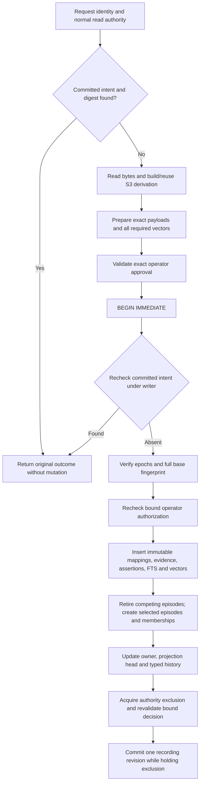
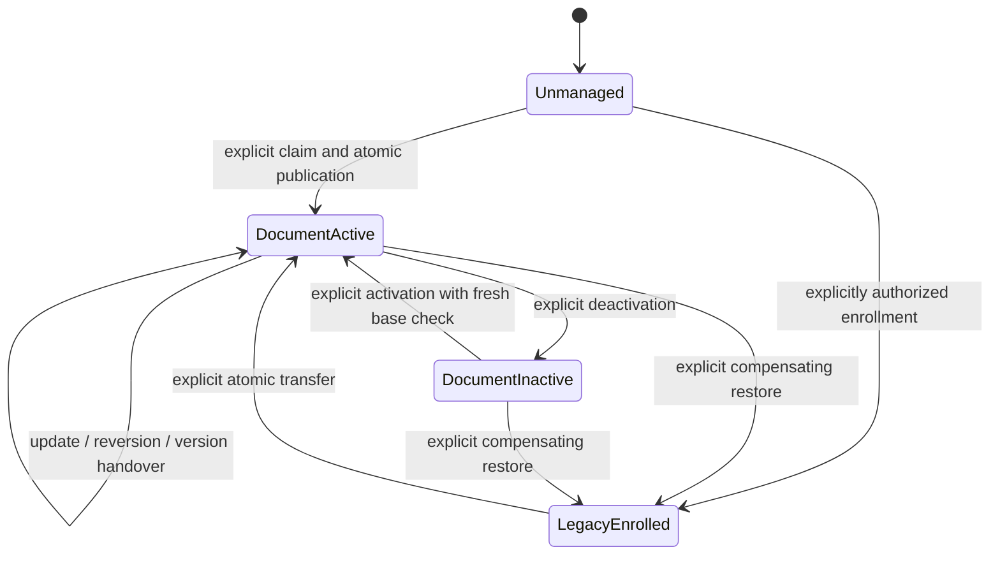

# M8 S3a: cross-kind ownership and retrieval projection

Status: **ACCEPT for Model-A local administration feasibility/design planning**.
[Trusted local F-only S3b](m8-s3b-ownership-core-plan.md) is the authoritative first slice.
Its explicit trusted OS-account/process boundary does not authenticate a distinct human.
Model-B principal-bound authority and cross-kind publication remain deferred/unimplemented.
Sections 1–12 retain the broader, deferred cross-kind retrieval direction: explicit
ownership transfer, separate immutable file/document identities and the assertion/memory spine. This document implements nothing. No migration, ingestion,
indexing, retrieval, MCP or sandbox code changes are authorized by this gate. No S4.

Baseline inspected: `a60e7c118d90097e56972bc4ec1957a8e7b8d245` on
`feat/m8-s3-chunking`, `/tmp/mindspace-m8-s3`, clean at the initial S3a handoff; both design documents were uncommitted when this authority-feasibility gate began.
Parent S2 is `0bcf447`; `main` and `origin/main` remain `92f68ff`.
S3 chunking/persistence is accepted; projection is absent. The preceding full-suite
result was 1,019 passed / 0 failed / 8 ignored; this design does not claim a new full run.

Evidence labels: **Observed** = inspected source or named executed experiment;
**Proposed** = required future behavior; **Reasoned** = implication of inspected code;
**Open** = unmeasured or not implemented. Reading a proposed table name is not evidence
that it exists. All source references below refer to the S3 commit. Proposed cross-kind states/tables
are not the S3b schema; section 13 and the S3b contract override the earlier slice plan.
The prior Model-B authority gap remains true for that stronger model. The current
Model-A selection and explicit changes in guarantees are in S3b section 1 and section 16
below. Projection strategy A in section 3 is a different comparison from authority Model A.

## 1. Current execution and persistence boundaries

| Ref | Observed source | Consequence |
| --- | --- | --- |
| E1 | [ingest/mod.rs](../src/ingest/mod.rs#L57), `ingest_path`/`extract_path_with_deadline`; [markdown.rs](../src/ingest/markdown.rs#L15) | Single-file ingestion canonicalizes its path. Plain-directory ingestion observes a root; Git-directory ingestion observes committed Git objects instead. Legacy Markdown yields trimmed flat section bodies and heading subjects, not S3 slices. |
| E2 | [sqlite.rs](../src/storage/sqlite.rs#L3449), `record_observation_tx`, `logical_at` at 3860; producer constant at 66 | File identity is database-wide kind + location/state, not space scoped. The owner family is `file:legacy`. Full directory observations infer moves/absence only for `kind='file'`. |
| E3 | [sqlite.rs](../src/storage/sqlite.rs#L3887), `ensure_version`; [0002](../migrations/0002_source_lifecycle.sql) | Source versions are immutable and unique by logical ID + canonical content hash. Reversion may reuse an older source row; a timestamp-max query is not a document publication head. |
| E4 | [documents.rs](../src/storage/sqlite/documents.rs#L235), `record_inner`; [0010](../migrations/0010_documents.sql) | A `document` logical ID is separate from a `file` ID at the same canonical path. Document-source checks and the unique document-location index prevent simply substituting a file ID. |
| E5 | [chunk.rs](../src/ingest/document/chunk.rs), [documents.rs](../src/storage/sqlite/documents.rs#L403), [0012](../migrations/0012_doc_chunks.sql) | Versioned chunks bind source bytes, canonical revision, extraction, chunker, token contract and ranges. S3 creates no evidence/assertion/memory/FTS/vector. There is no selected active projection pointer. |
| E6 | [sqlite.rs](../src/storage/sqlite.rs#L4214), `reconcile_logical`; `get_or_create_assertion` at 4416 | Reconciliation reads active memories of one logical ID AND one producer family. Subject/order pairing reuses the old assertion if text matches; that would retain an old document citation when provenance changes. |
| E7 | [0001](../migrations/0001_init.sql), `evidence`, `assertions`, `memories`; [sqlite.rs](../src/storage/sqlite.rs#L1255) | Evidence is unique on `(source_id,kind,ordinal)`. Assertion identity includes evidence + extraction + normalized subject + content hash. Producer family is immutable. Memory rows are belief episodes; only one active episode per assertion is allowed, not one per physical file. |
| E8 | [indexing/mod.rs](../src/indexing/mod.rs#L71), [sqlite.rs](../src/storage/sqlite.rs#L2675) | Indexing scans all missing assertions, including historical ones, constructs `subject: content`, and calls generic `embed_document`. Precomputed strict vectors do not protect a later reindex or model change. |
| E9 | [runtime.rs](../src/embeddings/runtime.rs#L128), [budget.rs](../src/embeddings/budget.rs) | Only explicit `embed_document_validated` uses the pinned, fully counted encoding and rejects overflow. Generic Candle trait embedding retains legacy truncation. |
| E10 | [semantic.rs](../src/retrieval/semantic.rs#L150), [sqlite.rs](../src/storage/sqlite.rs#L2790), [fusion](../src/retrieval/fusion.rs) | Semantic readiness currently selects one legacy derivation key. Vectors under another key are not automatically searched. Hybrid deduplication by memory/assertion does not merge different legacy/document assertions. |
| E11 | [sqlite.rs](../src/storage/sqlite.rs#L2956), `search`, `search_vectors`; [retrieval/mod.rs](../src/retrieval/mod.rs#L645), `decorate` | Default search filters active memories before ranking/limits. Hits use immutable source title/location; decoration drops raw assertion ID and carries no S1 anchor. Memory detail separately exposes current source lifecycle. |
| E12 | [ADR-021](adr-m6-temporal-recording.md), [0008](../migrations/0008_temporal_recording.sql), [sqlite.rs](../src/storage/sqlite.rs#L1115) | M6 Stage 1 records row availability and histories; Stage 2 recorded-revision query reconstruction is deferred. Embedding-index and FTS-ranking history are explicitly unsupported. |
| E13 | [sqlite.rs](../src/storage/sqlite.rs#L762), `build_search_filters` | Existing `SearchQuery.at` filters episode timestamps using current memberships/indexes. It is not `belief_at(R)` or world-validity history. |
| E14 | [documents.rs](../src/storage/sqlite/documents.rs#L510), `resolve`, `erase` at 701; [document.rs](../src/core/document.rs#L732), `StoredCitation::resolve` | Exact extraction-bound anchors resolve retained canonical text. Blob erasure is by shared content hash, does not erase canonical text, and is not temporal retention reconstruction. |

### One physical Markdown file, today

For a new `/notes/plan.md`, explicit legacy ingestion canonicalizes the path, parses
flat fragments, starts one `begin_write`, creates/reuses file logical ID **F** and source
version **Fs**, inserts evidence/assertions/FTS as needed, and reconciles `file:legacy`
episodes and requested spaces. Search obtains those episodes through their assertion,
evidence and immutable source. Default indexing may independently add vectors later.

Explicit S3 ingestion of that same path reads canonical text, nodes and token-safe
chunks; one transaction creates/reuses document logical ID **D**, source version **Ds**,
extraction **X**, and chunk set **C**. F and D differ even when text and path agree.
Repeated S3 ingestion is a no-op. Search still sees F's episodes only. A directory
scan deleting/moving F does not update D. Equal text, a path match, or FTS deduplication
cannot establish a cross-kind ownership transition.

Observed disposable-database probe: a two-section Markdown file produced **2 active
legacy memories, 2 stored S3 chunks, 2 logical kinds at one path, and zero document
memories**. Legacy search IDs were unchanged after S3 ingestion. Repeating S3 consumed
no recording revision. After deletion and a full directory observation, F became absent,
D stayed present, and legacy knowledge stayed active. This is current behavior, not the
proposed ownership state machine.

### Corrections to the approved M8 design

[Design sections 8–9](design-m8-document-intelligence.md#9-incremental-ingestion-versioning-and-lifecycle)
remain the intended assertion-spine direction, but four optimistic assumptions need
explicit replacement: a new family alone cannot retire another logical ID; text-equal
pairing does not guarantee revision-bound provenance; a new embedding key does not
automatically participate in semantic retrieval; and existing M6 history recording is
not a complete as-of query implementation. S3 already replaced the byte heuristic with
actual token counting and narrowed cross-revision chunk-ID stability.

## 2. Invariants and scope of future cross-kind ownership

**Proposed mandatory invariants:**

1. A managed asset has one owner and at most one selected document projection. No
   competing active `file:legacy` and document episodes exist for that asset, in any space.
   Many chunks are one projection, not duplicate memories of one fact.
2. Preparation never removes the old searchable set. A switch is one committed database
   revision: readers see old or new, never a partial set or both. No publication occurs
   with failed required embeddings or missing citation mappings.
3. Every document assertion's content is exactly one S3 source slice, with its matching
   chunk/extraction/source and anchor. Same quote under another revision is different
   provenance. Display labels/context are not fabricated quoted text.
4. Unmanaged legacy inputs retain current behavior, including absence not retiring
   knowledge. No schema upgrade automatically opts a path into document ownership.
5. Original IDs and immutable history survive transfer, deactivation and restoration.
   Current owner is never used to hide historical episodes or rewrite old citations.
6. Repeat publication is a no-op only when the complete selected manifest, ownership,
   spaces and policy already agree. Derivation existence alone is not activation.

Ownership is **database-wide**, because legacy F is global by path and spaces are
additive labels, not separate owners. A transfer must inspect **per-episode** memberships, not just the requested spaces.
The union is an inventory, not permission to copy all content into every space: doing
that for nonuniform memberships could widen retrieval. Initially require identical
membership sets on all retiring episodes; copy that set plus explicitly consented
additions to every new episode. Nonuniform assignments block transfer/restore pending
a separately reviewed mapping or explicit widening/removal consent. No implicit space
removal, widening or per-space split ownership is permitted in the first future publication slice.

An asset is an explicit association between D and an optional selected F, plus canonical
location bindings. Do not merge identities by equal bytes, filename or inode. Copies at
different locations, Git commit sources and manual memories remain separate knowledge.
Pre-existing ambiguous file identities at one path, unknown producer families or conflicting
claims block activation pending explicit disambiguation. This gate does not retroactively
deduplicate unrelated legacy knowledge or infer that a reused path is the same asset.

## 3. Strategy comparison

The alternatives are evaluated for correctness before implementation size. Each requires
operator consent before changing existing retrieval eligibility.

| Property | A. Explicit transfer (recommended) | B. Both active, mutually exclusive visibility | C. Shared logical ID, versioned representations | D. Document-only retrieval, no memories |
| --- | --- | --- | --- | --- |
| Legacy compatibility | Unmanaged writes unchanged; opted paths explicitly fenced | All search/detail/count paths need ownership gating | Kind-dependent identity and uniqueness migration | Existing search must federate a new store |
| Duplicate suppression | Retire/create episodes atomically; no active competitors | Duplicate active memories persist internally; one missed filter leaks them | Still needs representation-owner rule | Still needs suppressing legacy across modes |
| Identity/provenance | Preserve F and D; explicit association | Preserve both, plus visibility history | Re-parent/reinterpret immutable sources and document-kind constraints | Precise chunks, separate result identity |
| Historical retrieval | Existing episodes + new ownership/projection history | Replay visibility before limits for every historical query | Migrate old identity histories without inventing equivalence | Rebuild episode/membership history outside spine |
| Temporal semantics | Bounded recorded-revision adapter required | Adapter must also replay every visibility gate | Broad cross-kind history migration | A second temporal lifecycle is required |
| Index invalidation | Strict doc payload key, keep historical FTS/vectors | Same key work, plus hidden-candidate filtering | Representation key still mandatory | Separate FTS/vector readiness, ranking and fusion |
| Transactions | Moderate: cross-ID retirement/publication + CAS | Moderate/high: gate/history/index consistency | High: source/evidence identity migration | High: coordinate two retrieval systems |
| Reversibility | Compensating transfer; no history deletion | Flip gate, but membership/index readiness must be restored | Difficult to unmerge identities | Disable store, then restore legacy safely |
| Consent | Preview affected IDs/spaces/modes and directory conflict policy | Hidden-state switching is hard to explain | Consent to identity/history rewrite | Consent to different retrieval semantics |
| Performance | Reuse existing queries; batched projection and keyed ownership checks | Eligibility joins in every mode; post-limit filtering is unsafe | Potentially fewer joins after costly migration | Extra candidate pools, federation, caches and ranking |

**Decision A:** a small ownership coordinator and identity-sensitive document projector,
using existing memory lifecycle states. This adds metadata/control state, not a second
belief lifecycle. B fails the active-memory invariant and risks candidate starvation;
C conflicts with current kind-specific storage; D duplicates too much retrieval/history
while leaving ownership unresolved. A is not just a call to `reconcile_logical`.

## 4. Proposed data model and write authority

These are **deferred cross-kind** conceptual tables, not the F-only S3b schema or
migration SQL; final names and migration number require implementation review. Keep the existing document/source tables unchanged.

| Proposed record | Minimum information and constraints |
| --- | --- |
| `asset_ownership` | Stable asset ID, nullable selected F, D, owner/state, epoch, selected projection manifest, current publication R. At most one ownership association per selected logical ID. Mutations require the existing write revision and typed history. |
| `asset_locations` | Canonical location, asset/binding state, monotonically changing binding epoch. Unique current claim per location. Released bindings retain tombstones/epochs to detect ABA; historical bindings record R. |
| `document_projection_manifest` | Immutable X/C identifiers and plan hash, projector policy, exact chunk IDs, projected/skipped counts, payload policy/model/index policy, publication availability R. A committed selected head is explicit, never inferred by newest extraction timestamp. |
| `document_chunk_projection` | Unique exact chunk/projector identity → evidence/assertion IDs, source ID, full anchor, source/payload hashes and pairing slot. Foreign-key and hash/range consistency checked by the receiver. |
| `asset_transition` | Unique caller intent ID and request digest, expected epoch/fingerprint, old/new owner/manifest, affected episodes/spaces, result and committed R. Append-only history supports retries and audit. |

A manifest can reuse immutable S3 derivations stored earlier without making them searchable.
Optional durable preparation records contain no ordinary memories/assertions/FTS; they are
unpublished work and must be bounded/cleanable separately. The initial implementation can
keep prepared vectors in a bounded in-process plan and fail with an explicit size limit;
large-plan staging needs its own reviewed resource contract, not silent partial publication.

### Metadata migration and recording authorization

The future additive migration is itself one atomic cutover, **not** an ownership transfer.
It creates empty control tables/histories and marks new-domain coverage known from
`R_meta`; it creates no asset claims or belief episodes. Existing core M6 baseline B and
its histories remain unchanged. One new metadata recording revision is expected; migration
compatibility does not mean the recording counter is byte-identical after an upgrade.

Observed constraint: `init_conn` registers revision authorization at zero, and
`run_migrations` owns a raw `BEGIN IMMEDIATE`; only migration 8 currently installs the
original baseline. Fenced coverage tables cannot be populated by ordinary raw migration
SQL, and calling `begin_write` inside the migration transaction would be a nested write.

Proposed dedicated storage-owned protocol for this migration:

1. In the already-open migration transaction, verify that M6 exists, no other write
   authorization is active, and the migration is not already applied. Compute the checked
   next revision from `MAX(m6_revisions)+1` while holding the writer lock.
2. Enter a private RAII migration-authorization scope on that same connection/RevisionState;
   arm `m6_write_revision()` with that R, then insert `m6_revisions(kind='write')` under the
   normal fence. Do not start a nested transaction, set a global bypass, or drop fences.
3. Create the new metadata tables, typed history/availability enforcement and coverage
   registration with `complete_from=R_meta`. Install only the new required persistent
   fences/snapshots. Include the normal schema-migration registration in this transaction.
   Do not replay `apply_m6_baseline` or backdate owners to B.
4. Commit through the same conservative commit-outcome classification as knowledge writes,
   extended to the migration-owned transaction. Clear authorization on every exit, including
   panic/drop/error; discard a connection with an uncertain/still-open transaction. A raw
   migration commit mapped to an undifferentiated storage error is not sufficient.
5. On lost acknowledgement reopen normally: schema registration, new coverage and R_meta
   either all exist or none do. An already-applied migration performs no writes and allocates
   no extra R. If absent, retry from the unchanged old schema; do not independently retry
   pieces or treat an old committed revision as fresh write authorization.

This requires a bounded migration-runner/authorization change, not just a new SQL file.
Its API and enforcement deserve separate review before implementation. Test late DDL/coverage/history
failure, vetoed commit, unknown commit outcome, reopen after each outcome, repeated open,
old baseline stability and unauthorized raw writes. New tables must appear in the new
binary's persistent-enforcement inventory. Older binaries must refuse the newer schema.

### Evidence and episode identity

Do not feed a second extraction's drafts into `ensure_version` and assume it will insert
new evidence: an existing source returns existing evidence by ordinal. Do not restart
chunk evidence ordinals at zero for every version. Allocate new `EvidenceKind::Section`
ordinals from a **per-source monotonic sequence inside the publication transaction**;
record the immutable mapping so retries/reversion reuse them. These ordinals are storage
keys, not source positions. S1 anchors/ranges are the source position authority. This
avoids changing the existing evidence uniqueness contract or inventing line positions.

Use a fixed family **`doc:chunk@1` as projection-policy epoch 1**, independent of extractor
and chunker versions. Assertion extraction identity includes projector version and full
S3 chunk identity; the mapping binds exact source/X/C. A projector-policy epoch change
requires explicit family handover; a chunker/extractor change changes provenance under
the same owner/family. This refines the earlier design's per-derivation family proposal.

A dedicated document reconciler compares exact chunk/projection identity, not just quote
text. If it is unchanged, reuse the active episode and add explicitly requested spaces.
If provenance changes, create/reuse the exact immutable assertion and create a new
memory episode even for byte-identical text. Never reopen a retired/superseded episode.

The assertion's **display/FTS subject** is bounded immutable document-title and available
section-heading metadata from the cited source/extraction, never the opaque pairing slot.
Use a deterministic 512-UTF-8-byte display bound, cutting only on character boundaries;
retain full context references independently. Filename-derived fallback titles remain
findable for headingless documents. Normalize this display subject using the existing
subject-normalization rule; keep the pairing slot in the projection mapping separately.
Labels are labelled metadata, not part of the exact quote or vector payload. Full heading
source text remains covered by S3 even if a display label is shortened. Old/new query
coverage must be tested; different retrieval units do not promise identical ranks/snippets.

Pairing slots (enclosing section path or root + chunk ordinal) are versioned hints, not
identity. Only a unique, unambiguous old/new slot may produce a one-to-one `superseded_by`
edge. Splits, merges and ambiguous reordered slots retire/create with transition-manifest
links; do not claim semantic continuity by equal text or shift all `#n` chains silently.
At cross-kind handover retire legacy episodes with a transfer reason and manifest link,
rather than fabricating one-to-one supersession between incompatible section/chunk units.

Project every non-whitespace source chunk verbatim. Whitespace-only chunks retain their
S3 coverage/anchor and receive a manifest skip reason, not an empty semantic assertion.
No non-whitespace bytes may be skipped. An empty effective projection cannot replace a
searchable legacy set without a separate explicit clearing decision; initially refuse it.

### Guard every legacy writer, not just the user-facing entry point

Add an ownership lookup to extraction context for a preparation token, then recheck under
the writer **before any session, source, scope, reconciliation, move or absence write**.
Fence direct `record_observation` and the confined/broker persistence paths, not only
`ingest_path`. Check observed locations, owned aliases under a full root (including missing
files), and associated legacy IDs. A scope label does not bypass a database-wide claim.

Initial policy: a legacy file or directory observation intersecting a reserved document
asset fails **the whole observation** with an explicit ownership conflict. Do not skip
and then mark skipped files absent. Do not silently invoke document extraction instead.
Other roots/files remain usable. Consent preview must explain this conservative directory
consequence. A future ownership-aware mixed observation adapter is separate work.

Recheck path-binding epochs even for currently released/unclaimed paths. Without a retained
epoch, prepare-before-transfer → move/release → stale legacy write could pass an absent-row
check and recreate the wrong lineage. New unrelated content at a released old location may
create a new F only after a fresh observation; it must not attach to the moved asset.

## 5. Publication transaction and reader guarantees

### Operator authorization is distinct from recording authorization

This distinction applies to **legacy enrollment itself**, not just publication. The
[S3b local administrative contract](m8-s3b-ownership-core-plan.md#3-minimal-local-administrative-interface-and-target-binding)
is authoritative for the first slice: direct trusted local OS-account administration,
explicit DB/F/action/base/transition/full-intent binding, private context, immutable
successful receipts and SQLite logical fencing. No MCP caller, metadata edit, path grant
or ordinary recording scope can enter that route. It deliberately excludes malicious
same-UID shell/DB writers and makes no independent human-authentication claim.

The rest of this section describes **deferred publication**, not A's enrollment protocol.
It retains the stronger principal/decision and ordered revoke/lease requirements pending
its own authority threat-model review. A does not supply or prove those Model-B mechanisms;
do not copy their unavailable issuer/lease requirements back into the F-only local slice,
or apply the weaker local trust assumption to publication without a separate decision.

A storage-owned recording revision authorizes fenced SQLite writes. It **does not**
authorize changing a file's retrieval owner. A completed derivation, intent UUID, caller
boolean, source text/metadata, path grant or possession of `m6_write_revision()` is not
operator consent. Existing S3 derive/store calls cannot mint an activation authorization.

The future trusted activation surface must obtain an explicit operator decision after
preview and produce an opaque, verifiable `OwnershipAuthorization`. Its approval binds
the database instance and trusted caller, transition/action kind (activate, update,
deactivate, restore or relocate), intent/request digest, selected F and D, target
manifest and projector/index policy, required search modes, ownership/location epochs,
exact source/base and per-episode membership fingerprints, and the approved additions or
removals. The canonical request digest includes that action kind. A changed action/plan/base is
a new approval decision, not permission to broaden an
old one. The authority adapter must check validity/revocation/freshness according to its
reviewed policy. Arbitrary document content or generic ingestion requests cannot create
that proof; the proof-creation/validation boundary is an implementation prerequisite.

The publisher validates this authority before publication and rechecks its bindings under
the writer lock before ordinary projection writes. It must then acquire authority exclusion
and revalidate immediately before COMMIT, holding it through completion or proven committer
termination, using a separately reviewed Model-B ordering/recovery contract. Early validation alone is insufficient. Missing, mismatched, revoked or expired
authorization refuses publication and leaves old visibility/state untouched. Internal
write-revision authorization is necessary as well, never a substitute. Authority must
come from the authenticated/trusted operator integration, not from a new sandbox grant.

A retry of an already committed intent can return its original immutable outcome under
the caller's normal read authority, even after its old approval is no longer usable for
new writes. That is a nonmutating status result, never fresh authorization or a replay of
the old head. A new attempt to mutate state still needs the exact valid operator decision.
No activation surface is implemented or exposed by S3a or the first foundation slice.



The early recovery/status lookup is read-only and checks caller read authority and the
stored request digest before returning an outcome. It requires no live file, fresh vectors
or renewed approval. Absence is only an observation of that read snapshot, not proof that
no concurrent writer or unpublished derivation exists. Retain the inside-writer intent
recheck; a race-loser returning a committed outcome rolls back its unused allocated R.

All steps before D preserve existing search results. Generic indexer calls and independent
`Store::save_embeddings` transactions cannot implement F. A new store-owned publication
method composes transaction-private helpers with the existing commit-outcome machinery.
On precommit failure or a definitively uncommitted COMMIT error, including authorization
refusal, the transaction rolls back together, including any allocated revision, FTS,
memberships and history. `CommitOutcomeUnknown` is different: the complete old or complete
new state may be durable. Reopen and resolve the same intent/digest before deciding whether
to retry; never promise rollback merely because the caller received an error. Atomicity
excludes partial publication, not an acknowledged outcome after every COMMIT.

The read-only status branch above requires no fresh activation approval; it returns only
an already committed intent with the same digest. A digest mismatch is an error. A miss
is not proof of noncommit while a writer is still pending: recheck under the serialized
writer before allocating publication work. The inner intent lookup remains mandatory,
including after an approval expires or another transition advances the head.

Inside D: look up an already committed intent **before** rejecting an advanced epoch.
Same intent + same digest returns its committed result without another revision; a reused
intent with changed input is an error. An old committed intent retried after a later
transition reports its original outcome/R, never restores its old head. If no intent exists,
validate the owner/path epochs AND exact active-episode, source and per-episode space-membership base
fingerprint. Epoch alone does not catch a concurrent manual retirement or added space.
Conservative first implementation may compare the full expected recording revision instead.
Stale work is refused/reprepared, not merged opportunistically.

The selected-head update, retiring legacy episodes and creating document episodes are
one transaction. A read request uses one consistent SQLite read snapshot across lexical,
vector, ownership diagnostics and citation enrichment. Today multi-branch retrieval is
not a proven single-snapshot cutover contract; implementation must establish that session
using transaction-private read helpers (not recursive locking of the ordinary Store mutex),
or recheck a snapshot revision and retry the complete request. Do not fuse pre-switch
legacy candidates with post-switch document candidates from separate snapshots.

A direct memory mutation affecting a managed asset must also participate in this protocol:
no untracked bulk retirement/reactivation outside ownership reconciliation. Individual
manual retirement may remove an episode but cannot create another producer; the base
fingerprint catches it during preparation. An explicit re-ingest may recreate a manually
retired document episode only under the current active owner/manifest. Inactive ownership
is a persistent fence, not permission for implicit reactivation.

## 6. Lifecycle state machine

Preparation is unpublished work, not a retrieval owner. The complete diagram below is a **deferred** cross-kind state machine; S3b permits only
the explicitly authorized Unmanaged→LegacyEnrolled edge. Core states are proposed
ownership states; memory states remain the existing active/superseded/retired states.



`LegacyEnrolled` is the only persisted owner state permitted in S3b (epoch 1). The
other states and compensating restore below are deferred and require a later migration
and separately authorized transitions. In that future model it includes an explicitly
restored legacy owner; ordinary unmanaged legacy
ingestion need not create ownership rows. Presence (present/absent/unavailable) is a
separate coordinate. Absence is not falsehood. Binding epochs order claims and releases;
recording revision R orders committed transitions. Wall-clock time does neither.

| Trigger | Proposed result | Active retrieval / history |
| --- | --- | --- |
| First document ingestion | Existing S3 API remains derive/store only. Separate explicit activation prepares a manifest and claims the path; no implicit upgrade of existing calls. | No document memories until publication; successful activation creates one selected set. |
| Legacy F already at location | Preview selected F/D, all retiring episodes and their membership sets, old/new chunk counts and index coverage. Require uniform memberships initially. Refuse ambiguity/unknown families. Require explicit transfer. | F stays active until one transaction retires F and publishes D. No query-only hiding. |
| Identical repeat | Compare complete desired head/policy/spaces; resolve prior intent if retry. | Same active episodes/assertions; no new recording revision. S3 derivation reuse alone is insufficient. |
| Content modification | New exact X/C and projection; same owner; identity-sensitive reconciliation. Derive-only calls do not advance the selected head. | Old stays searchable until replacement commits. Equal quotes in a new revision still receive new provenance. |
| File move | Initially require explicit relocation with selected asset/expected epoch and verified bytes; do not infer a cross-kind move from a matching hash. Rebind D and any associated F locator plus location history atomically. | Keep exact old anchors and frozen source locations; show new current locator separately. Release the old alias explicitly with a retained epoch. Ambiguous move+edit/copy is refused until explicitly disambiguated. |
| File deletion | A future explicit document observation records absent after authoritative observation. A failed open/permission error reports unavailable, not proven deletion. | Keep knowledge active, matching legacy semantics; citations report current byte availability. A legacy directory scan touching the reservation conflicts, even if the file is missing. |
| Reversion to older revision | Reuse exact old X/C, mapping and assertion when available, but publish it as a new transition from the current head. | New belief episodes at new R; old episodes are never reopened. Repeating that selected reversion is a no-op. |
| Extractor/chunker/token-contract change | New immutable derivation/provenance, prepared and selected explicitly. Do not use newest-created extraction as owner. | Atomically replace old episodes; even identical text cannot keep the wrong anchor. Existing projector family stays `doc:chunk@1`. |
| Projector policy change | New projector family/version, explicit reviewed family handover. | Retire all prior selected-family episodes in the same transaction; retain history. |
| Partial embedding/indexing failure | Retain candidate work only, report exact failure; do not commit ordinary candidate assertions or retire old knowledge. | Required-vector policy blocks publication. No automatic downgrade to lexical-only after failure. |
| Lost commit acknowledgement | Return existing `CommitOutcomeUnknown`; reopen and look up the same intent/digest. | Return the original committed outcome, or, after fencing the old attempt and a healthy serialized absence check, retry only with current authority against the unchanged approved base. Never guess, duplicate, or replay an old head over a newer one. |
| Explicit document deactivation | Retire selected document episodes and record intent/R; retain D, all immutable rows and location reservation. | Removal is explicit; legacy ingestion remains fenced. Do not reactivate F automatically. |
| Abort before publication | Discard/expire unpublished work. | Old state and results remain unchanged; no compensating belief event is needed. |
| Rollback after publication | A new compensating transition prepares fresh legacy observations (or explicitly selected retained legacy data if the file is gone), validates epochs and performs restore. | New legacy episodes, no rewriting old timestamps/history. Refuse restore without complete selected content/space/index readiness. Missing fresh bytes are not silently treated as current. |

Publication must preserve the modes already usable for the selected legacy asset. If
active legacy facts have compatible semantic vectors, transfer requires all necessary
strict document vectors ready under the current selected binding. Model-binding changes
during preparation invalidate the plan. First activation without such prior coverage can
explicitly choose `lexical_only`; its mode limitations are part of consent/readiness.
A later explicit availability downgrade needs separate approval; it is not a failure fallback.

## 7. Exact token payloads, vector routing and citations

### Existing trap and required call chain

Observed executable counterexample: `hello ` repeated 2,042 times is exactly **2,048**
tokens under S3. Prefixing `Heading: ` as the generic indexer does produces **2,050**;
strict validation rejects it. Generic Candle embedding would truncate it. Therefore S3
chunk validation followed by the current generic indexing call is **not** a safe path.

Proposed path, required for first publication and every later backfill/rebuild/model change:

```text
selected chunk ID -> exact canonical UTF-8 slice -> payload hash
    -> TokenBudget(selected model): prefix + full slice + special tokens <= 2048
    -> strict document embedding interface
    -> CandleRuntime::embed_document_validated(slice) -> same validated token IDs
    -> finite/dimension checks -> prepared vector + exact policy descriptor
    -> transaction-private save tied to the document assertion mapping
```

Only S3 source text is the document embedding payload. Subject, heading breadcrumbs,
section paths and display labels are not concatenated. If a future policy adds context,
it needs a new payload identity and validation of the entire augmented string; it cannot
inherit the source-only token count or claim copied context belongs to the cited range.
The pinned model normalizer/UNK behavior remains model behavior, not source-byte loss.

A future index router must classify assertions by immutable projection mapping, select
the corresponding payload/derivation, and dispatch to a strict document interface. A
trait extension can default to **unsupported**, never generic truncating fallback. Tests
must use a sentinel runtime whose legacy embedding method panics for document assertions.
Also validate the assertion/payload-policy key at vector persistence, so direct generic
backfill cannot store a document vector under the legacy payload key.

Keep the legacy derivation codec/key unchanged. Define a separate document descriptor
encoding the same pinned model/tokenizer/runtime/pooling/normalization fields plus
`payload=doc-source-slice@1`, actual budget-contract identity and `truncation=reject`.
The chunk/mapping identifies the source input; the vector row remains keyed by assertion
and pipeline descriptor. Do not reuse a vector merely because quote strings match across
policies. Cross-assertion payload caches are optional future work, not a prerequisite.

The semantic resolver must advertise **compatible payload-key groups** for the one selected
model. Its single query embedding can rank legacy and document vectors only when model,
tokenizer/query strategy, dimensions, pooling and normalization are compatible. Select
the right key for each assertion class; do not query two keys indiscriminately and count
one assertion twice. Never compare vectors from different model spaces. Old incompatible
vectors remain stored but are ineligible. Status/backfill/clear/rebuild must use the same
routing plan; the current all-assertion one-key indexer is not sufficient.

For active document sets, readiness reports missing/failed policy-specific coverage.
Explicit semantic mode must report incompatible/incomplete required coverage rather than
silently returning an empty document subset. Auto mode may use a disclosed lexical fallback;
no document claim changes unmanaged legacy-only behavior. Querying never installs models,
indexes, or changes ownership. The semantic session cache holds model runtimes, not search
results: update its readiness identity for payload groups, without inventing a result cache.

FTS entries are immutable assertion content/subject rows inserted with publication. Retiring
an episode does not delete its FTS/vector rows: history still needs them. Current eligibility
filters remove retired episodes **before candidate limits/fusion**. Reindexing changes
only derived indexes, never a quote or anchor. Explicit vector clearing yields a visible
readiness change and cannot claim a document is still fully semantically indexed.

### One result citation contract for every mode

Add a shared batch enrichment step while raw assertion IDs are still available, before
`decorate` discards them. Lexical, semantic, hybrid, auto fallback and historical adapters
must all use the same immutable assertion → chunk mapping. Proposed optional document
citation fields: logical D, source revision/hash, X/C and chunk IDs, S1 anchor, precision,
quoted canonical range, source title/location at that revision, current locator/presence
as separately labelled metadata, and current citation availability/status.

Resolve the full mapped quote through S1; never reconstruct an anchor from a snippet,
heading, current file or result rank. FTS highlights and 160-character semantic windows
are display snippets, not authoritative exact-range quotes. Preserve raw canonical bytes;
escape bidi/zero-width/control characters for display separately and HTML-escape highlights.
Existing legacy results retain their current shape; additive document citation fields and
serializers need compatibility tests, with no new/default MCP tool definition change.

Erasing `doc_blobs` by hash affects all documents sharing those retained original bytes.
It does not remove canonical text, chunks, assertions, episodes, FTS or vectors, and it
is not document deactivation or a right-to-erasure implementation for all knowledge.
Historical quotes remain text-resolved; current original-byte resolution may be unavailable
or independently verified from the live file. A historical belief at R never proves that
erased bytes are retrievable now. Retention history is not reconstructed or fabricated.

## 8. Temporal contract: three distinct questions

1. **Current retrieval:** selected active episodes, current memberships and selected-model
   readiness; normal legacy behavior remains the default.
2. **Existing `SearchQuery.at(T)`:** preserve its established episode timestamp semantics.
   Retire/create at the same transition timestamp for a handover, but never add a current-owner
   filter to old episodes. Existing current-membership/ranking limitations remain explicit.
   Timestamp equality or a clock rollback cannot provide authoritative transaction ordering.
3. **Proposed `belief_at(R)` adapter:** an explicit new internal query mode, not a reinterpretation
   of `at`. Reconstruct latest history snapshots ≤ R for episodes, spaces, memberships, links
   and logical source state; require immutable source/evidence/assertion row availability ≤ R;
   join ownership transitions and projection mappings known at R. Reject pre-baseline/unsupported
   dimensions using existing coverage checks plus the new ownership/projection coverage.

Projection mappings/manifests require recorded availability and ownership-state history
inside the publication transaction. Existing S3 side rows are outside M6's complete
availability inventory: their old extraction timestamp is not a recording revision.
A first publication establishes that its referenced immutable derivation is known by that
publication R; do not fabricate its earlier derivation/retention history. A reversion can
reuse that mapping but still needs its new episode/head history. New metadata migrations
must backfill only facts actually known at their cutover, not infer undocumented past owners.

Historical **eligibility** is separate from historical **ranking**. Initial recorded-revision
queries may explicitly request `ranking=current_derived`: rank R-eligible immutable facts
using current FTS/current compatible vectors/query runtime, and disclose that policy and
current model descriptor. Vector creation after R is permitted only as a declared current
ranking artifact, never evidence of historical index availability. Reproducible historical
FTS/vector ranking remains unsupported and must fail closed; do not mark `EmbeddingIndex`,
`FtsRanking`, world-validity or historical configuration as covered. No hidden fallback from
an exact-history request to current semantics is permitted.

This bounded adapter is a prerequisite for claiming recorded-revision document retrieval.
It is real implementation work still absent at S3. Do not activate the new public ownership
surface while required temporal, citation or strict-index routing gates remain incomplete.

## 9. Executable acceptance and migration plan

The following are **future integration-test contracts**, not delivered APIs or passing
projection tests. Implement them in `tests/document_ownership.rs`,
`tests/document_projection.rs` and `tests/document_recorded_retrieval.rs` with disposable
SQLite databases, real migrations and existing commit-fault hooks. Once the corresponding
slice exists, run these named tests with `cargo test --locked --test <suite> <name>`;
release repeats and mutation variants are required before enabling publication.

| ID / proposed test | Setup and operation | Required assertions |
| --- | --- | --- |
| MIG1 `populated_legacy_upgrade_requires_explicit_transfer` | Build a schema-11 fixture with two legacy sections, two spaces with uniform memberships, FTS and vectors. Open with candidate migration runner, first through actual 0012, then the new metadata migration. | Existing IDs, active episodes, memberships, FTS, vector bytes and default search/tool output unchanged. No automatic claim/projection. M6 baseline is not rerun; exactly one new R_meta records metadata cutover. Explicit activation later retires F and publishes exactly the manifest's eligible D chunks in one R. |
| MIG2 `metadata_cutover_authorizes_one_revision_atomically` | Pause/fail after new DDL/coverage writes, veto COMMIT, lose acknowledgement; reopen and repeat migration/open. Try raw writes without authorization. | Schema registration/control/coverage/R_meta commit or roll back together. No nested write or fence bypass, old baseline unchanged, authorization cleared on every exit. Committed-unknown reopen applies nothing twice; rejected/rolled-back upgrade leaves old schema exact. |
| O1 `both_ingestion_orders_have_one_active_owner` | Legacy-first then activate D; D-first activation then attempt file/directory legacy ingest. | First order switches atomically; second reports ownership conflict with no session/revision/state changes. Exactly one active projection, no duplicate active search result for a chunk in lexical/semantic/hybrid. |
| AUTH1 `publication_requires_bound_operator_authorization` | A fully valid prepared plan and a storage-authorized write, but absent/mismatched/revoked/expired approval; also a different action kind, database, target manifest, epoch, index policy or membership decision. Then test the exact authorized case. | Every unauthorized case preserves all old ownership/results/publication tables and spends no committed R. A UUID/digest, `m6_write_revision()` or source-provided “approval” cannot authorize transfer. Exact authorized publication is tested only when the later publication/visibility implementation exists; it is not simulated in the first slice. |
| O2 `unmanaged_and_ambiguous_inputs_are_preserved` | Unmanaged Markdown/Git/manual fixtures; ambiguous F identities, copies, unknown families or two claims at one path. | Unmanaged outputs identical to baseline. No hash-based merging of copies. Ambiguous activation fails without retiring anything. |
| O3 `memberships_are_not_lost_or_widened` | Uniform two-space F; then nonuniform per-section spaces and a concurrent membership edit. | Uniform transfer preserves both spaces. Nonuniform transfer is refused initially; no silent union widening. Stale prepared fingerprints fail; no old/new mixed ownership across spaces. |
| O4 `whole_directory_conflict_includes_missing_owned_paths` | Full root has unmanaged files plus a missing/ignored owned file. Call each direct/broker persistence entry, not only `ingest_path`. | Explicit whole-observation conflict before writes/absence/move inference; all old results survive. Other nonintersecting roots work. |
| O5 `claim_epoch_prevents_stale_and_aba_writers` | Pause legacy preparation; activate D, relocate/release old alias, then resume. Also race two activation intents and legacy-first/activation-first writers. | Epoch/base checks prevent stale resurrection and ABA. One winner; loser refreshes. Six-connection repeated runs do not spend extra R for duplicate intents. |
| P1 `repeated_plan_and_intent_are_idempotent` | Repeat exact activation/new intent; lose ACK then retry same intent/digest after reopening, including after a later head change, source deletion, model unavailability and approval expiry. | No new assertions, episodes, vectors or R for exact repeats. Prior committed intent returns original outcome only; it never reactivates an older head. Reusing an intent with changed payload errors. |
| P2 `equal_quote_new_provenance_gets_new_assertion` | Shift an unchanged paragraph's offset by editing earlier content; change only extractor/chunker identity. | Exact new chunk/anchor/source mapping and new episode/assertion. No content-only reuse of the old anchor. Old citations still quote old text. |
| P3 `evidence_ordinals_survive_multiple_derivations` | Publish two chunker/extractor sets of the same canonical source and then revert. | No `(source_id,kind,ordinal)` collisions; stored mappings reused on retries; current slots do not impersonate source positions. |
| P4 `split_merge_and_reversion_do_not_invent_lineage` | Insert/delete a paragraph, split/merge chunks, duplicate headings, then revert to old bytes. | Unique slot matches only for supersession; ambiguous transitions retire/create. Reversion reuses exact immutable data but creates fresh episodes; no old episode is reopened. |
| P5 `partial_index_and_sql_failures_preserve_old_search` | Fail the nth required strict embedding; inject failure after FTS/mapping/vector writes and before retirement/head update; veto COMMIT. | Previous owner/results stay intact across all modes; no ordinary staged assertions leak. Every transaction table/history and current head rolls back. No silent lexical fallback after semantic-required failure. |
| I1 `document_indexing_never_calls_legacy_payload` | Exact 2,048-token source with nonempty heading subject; sentinel legacy runtime panics for doc assertions. Initial index, clear/backfill/rebuild, model change and historical-assertion backfill. | All document calls use exact source-only strict payload and matching key; 2,049+ combined input rejects before weights. Generic/direct wrong-key saves refuse. Legacy subject formatting/key remains unchanged. |
| I2 `compatible_key_groups_and_readiness_are_truthful` | Mix legacy-key/doc-key vectors, wrong dimension/model, missing doc vectors and changed tokenizer/payload policy. | Compatible rows participate once; incompatible rows excluded; explicit missing-coverage error/fallback reason, not silent empty document subset. No query writes. Runtime-cache readiness is invalidated correctly. |
| R1 `all_modes_share_exact_document_citations` | Lexical-only match, semantic-only hit, hybrid overlap, auto fallback, control/bidi/emoji/CRLF input; shift/deactivate source. | Same immutable mapping/anchor in every mode, bounded snippets labelled as snippets, exact quote range/precision. Display escaping does not change stored source bytes. No source-range claim for metadata headings; filename/heading subject queries remain covered without requiring identical ranks. |
| R2 `cutover_query_is_one_snapshot` | Pause lexical branch, publish handover on another connection, then resume vectors/citation enrichment. | Request returns one committed snapshot or retries completely. No old/new mixed candidate pools, limits or metadata. |
| T1 `recorded_as_of_reconstructs_memberships_and_heads` | R0 legacy, R1 transfer, R2 membership/location update, R3 content update, R4 reversion/deactivation/restore. Include two commits with equal wall-clock time and a reversed clock. | `belief_at(R)` returns exactly each snapshot's episodes, spaces/links, original sources and correct current-at-R locator. Availability excludes later facts. R disambiguates timestamp ties. Existing `.at(T)` semantics remain unchanged and carry no false recording-history promise. |
| T2 `unsupported_historical_ranking_fails_closed` | Request before M6 baseline, unsupported world validity or exact historical index/ranking. Also use explicit current-derived ranking over R-eligible facts. | Unsupported requests fail with named dimensions; explicit current-derived ranking discloses model/policy and cannot introduce facts born after R. No fabricated ownership/retention past. |
| L1 `absence_deactivation_and_restore_are_distinct` | Delete file; authoritative absence observation; deactivate; recreate unrelated file at old alias; explicit compensating restore from validated content. | Absence preserves active knowledge, deactivation retires but reserves, unrelated file cannot steal lineage, restore creates fresh legacy episodes atomically with complete spaces/index readiness. Historical episodes stay unchanged. |
| L2 `blob_erasure_does_not_rewrite_belief_history` | Identical retained blob shared by two D identities; erase bytes then resolve old/current hits at different R. | Canonical quotes/history stay; retained-byte availability changes for both, truthful current live-check status. No automatic retirement/index deletion or fabricated retained-byte history. |

### Database oracles

In addition to public search assertions, use the actual canonical tables after each
operation; F/D below are the explicitly associated logical IDs:

```sql
SELECT m.producer_family, COUNT(*)
FROM memories m
JOIN assertions a ON a.id=m.assertion_id
JOIN evidence e ON e.id=a.evidence_id
JOIN sources s ON s.id=e.source_id
WHERE s.logical_id IN (:F,:D) AND m.state='active'
GROUP BY m.producer_family;
```

Before transfer only F's allowed family may be returned; after transfer only selected
D-family episodes may be returned. Check exact active assertion/chunk-set equality, not
merely family count: a duplicate set within one family is still wrong. Check every
active document quote against its mapped canonical slice and require one active episode
per selected assertion. Inactive/retired/historical episodes remain inspectable.

Snapshot the row counts/content of canonical tables, FTS, vectors, owner/head, intent and
typed histories around injected failures. Check `foreign_key_check`, `integrity_check`,
all persistent M6 fences, and no new recording revision on pure retry. Reopening after
lost ACK must distinguish committed and rolled-back states without cleaning data first.
Use two connections for concurrent readers/writers and barriers at prepare/begin/commit.
Mutation targets include deleting the writer guard, omitting provenance equality, resetting
ordinals, suppressing old results before new readiness, reusing the legacy payload key,
applying current ownership to historical results and replaying old intent results as writes.

### Real database migration feasibility observed now

A disposable **populated schema-11 fixture** was constructed with current public APIs
and actual legacy memories, then only S3 tables and migration-12 registration were removed
(as in existing version-upgrade tests). Opening it with the real S3 migration runner
applied 0012. Both legacy memory IDs/search results survived and the new chunk tables were
empty. This verifies additive S3 compatibility, not the proposed metadata migration or
ownership handover. MIG1 must repeat this scenario with the future migration and explicit
transfer. No user database was accessed.

Existing release suites were rerun for current-behavior evidence: documents/chunks, S1/S2,
lifecycle, M6 recording, indexing, retrieval and tokenizer boundaries. They do not exercise
unimplemented ownership/projection APIs. The standalone source-trace probe and its output
are local scratch evidence at `/tmp/m8-s3a-probe.rs` and `/tmp/m8-s3a-probe.log`.

## 10. Implementation slices and release gates

The authoritative first implementation contract is [S3b](m8-s3b-ownership-core-plan.md).
It permits only empty metadata installation and explicitly authorized F-only enrollment,
with durable receipts, enforced constraints, atomicity and logical recovery fencing.
It selects trusted local Model A; a generic principal/issuer system is not a prerequisite.
That stronger Model-B authority remains a gate for any feature that requires its guarantees. No document owner, path
reservation, producer migration or publication can be represented in that slice.

The earlier P1a proposal is retained only as the deferred alternative in section 14.
It is not a parallel first-slice specification. After S3b, separate reviewed work would
still be needed for:

| Later work | Required gate before exposure |
| --- | --- |
| Cross-kind association, location reservations/tombstones and every-entry legacy writer fences | O2/O4/O5, exact source/membership bases and authorized transitions; no automatic adoption |
| Exact projection plans, evidence allocation and provenance-sensitive reconciliation | P2–P4 and exact source coverage/citations |
| Strict embedding/payload routing, semantic readiness and shared result attribution/read snapshots | I1–I2 and R1–R2 across initial indexing and every rebuild/backfill |
| Recorded-revision reconstruction with explicit ranking policy | T1–T2; existing `.at(T)` unchanged |
| Atomic publication/deactivation/compensating restore | AUTH1/O1/O3/P1/P5/L1–L2, all read/write prerequisites together, real authority and concurrency/fault/mutation evidence |
| Explicit document observation/relocation | L1/R1/T1; distinguish absence, denied access, moves, copies and path reuse |

No chunk enters active search until publication and visibility invariants can be enforced
together. No parser, classifier, graph, broad migration, new MCP tool, Git-ingestion change
or S4 is authorized. Future ownership authority is a control-plane prerequisite, never
an expansion of the filesystem sandbox grant.

## 11. Risks, assumptions and feasibility decision

**Reasoned future publication feasibility, conditional on its authority review:** stable ownership associations and one atomic memory-spine publication
fit the existing transaction/episode/history model. S3 already supplies deterministic exact
chunks and strict embedding validation. No identity merge, second belief lifecycle or global
query-time deduplication is needed. This is more work than adding assertions, for concrete
reasons established by E6–E13.

**Explicit limits and open implementation evidence:**

- No atomic transaction spans SQLite and the filesystem. A plan publishes a named observed
  snapshot, not a guarantee that live bytes never changed. Recheck freshness before publication;
  mismatch refuses stale work, while later changes produce `source_changed` at resolution.
  Read authority remains the existing authorized path/root; ownership is not a sandbox grant.
- New ownership/projection coverage starts at the metadata cutover R. Earlier core legacy
  facts remain reconstructable when their existing coverage permits; earlier ownership
  annotations are unknown, and requests requiring them must fail rather than invent history.
- Nonuniform memberships, ambiguous path identities and unknown producer families are initial
  refusal cases. Product policy for mapping those cases is deliberately not guessed.
- Claims and bindings cannot prove physical identity through symlinks, inode reuse or copies
  alone. Canonicalization and expected epochs prevent common races; explicit relocation and
  alias release still need careful authority/freshness tests.
- Exact cross-DB chunk identity, historical ranking replay, world-validity, historical blob
  retention, original-file erasure and semantic equivalence across changed chunk boundaries
  are not promised. Do not make `source_present_verified` a permanent flag.
- Semantic routing is initially one selected model with compatible payload policies. Changing
  to another tokenizer/limit may require re-derivation; over-budget old chunks must error and
  request rechunking, never silently split/truncate behind one asserted citation.
- Prepared vectors, large manifests and metadata growth need measured memory/work limits.
  S3's bounded tokenizer windows do not make inference or publication storage cheap. Preserve
  optional embeddings and local-first operation; no mandatory LLM inference or query downloads.
- S3 measured a pre-existing S1 per-node full-text range-check bottleneck. Do not claim linear
  end-to-end ingestion or fold a generic performance rewrite into the ownership follow-up.
- Schema rollback after a committed upgrade is not history rollback. Use supported new binaries
  and compensating ownership transitions; restoring a whole database backup is an explicit
  operator recovery procedure, not an automatic downgrade/merge of divergent histories.

The recommendation, transitions, data flow and tests are reviewable. Model-A F-only
enrollment has a bounded implementable contract in S3b; protected principal-bound Model-B
authority remains unavailable and deferred. Neither assessment means the future migration,
strict routing, citations or recorded-revision adapter is implemented, tested or approved
for production. Those must pass their own gates.

## 12. Verification and gate outcome

**Historical initial S3a assessment: ACCEPT for design direction only; superseded by
the subsequent PARTIAL Model-B assessment and current Model-A decision in section 16.**
Projection strategy A remains the deferred cross-kind direction. No migration, enrollment or retrieval projection is enabled.

Recorded by the initial S3a gate (historical execution claims; the current finalization
checks are reported separately in section 15):

- Verified clean starting tree, S3 HEAD/parent, unchanged main/origin refs and S3's local
  cryptographic signature. No fetch/merge/push or new commit was performed.
- Read current ownership, evidence/assertion/episode persistence, directory lifecycle,
  strict/generic embedding, semantic key routing, source attribution and M6 Stage-1 code,
  plus the approved M8 design, S3 report and ADR-021.
- Eight existing targeted release suites: **164 passed, 0 failed, 3 ignored**: document
  chunks 15, S2 ingestion 30, S1 model 28, indexing 22, lifecycle 16, M6 recording 19,
  retrieval 29, tokenizer boundary 5. Log: `/tmp/m8-s3a-baseline-tests.log`.
- Disposable real SQLite probe: current cross-kind coexistence, identical-repeat no-revision,
  populated schema-11→12 compatibility, deletion preserving active knowledge, and the
  2,048→2,050 subject-prefix overflow counterexample all passed. No user database/model
  inference or proposed ownership migration was involved.
- Independent read-only Sol review: two findings corrected (migration authorization and
  display/FTS subject specification); final review has no remaining findings.
- Local document links, code-fence balance, final file scope and whitespace checked.
  The full 1,019-test baseline, Clippy and format gates were not rerun for this prose-only
  change. No proposed ownership/projection test is represented as already passing.

For historical result metadata, distinguish the immutable cited location, the logical
locator as known at R, and the current live-check locator/status at resolution. Never
label the latter as historically verified presence.

At the initial S3a handoff only this document was added, uncommitted, on the existing S3 branch. Production schema,
ingestion, indexing, retrieval, default MCP definitions and existing source files are
unchanged. No ownership was transferred. No S4. Stop for review.

## 13. Reconciled authoritative first slice

Narrow **F-only S3b** remains authoritative. Its authority is now the explicitly chosen
**Model A trusted local administrative operation**, rather than requiring Model B's
independent principal issuer. This changes the threat model/assurance claims openly;
no current same-UID mechanism has been reclassified as human authentication. P1a remains
only the deferred alternative in section 14.

| Subject | Normative first-slice rule |
| --- | --- |
| Scope | Existing file F only; Unmanaged→LegacyEnrolled, legacy owner, epoch 1. No D, path claim, publication head or search effect. |
| Authorization | Explicit direct admin CLI for the trusted database-owning OS account; exact DB/F/action/base/R/transition/intent confirmation. No untrusted MCP route, inherited target, metadata grant or generic write context. |
| Actor | Kernel-derived real/effective UID, labelled OS account. No client-supplied principal, distinct human attribution or same-UID adversary resistance. |
| Immutable intent | Full ID contains version/nonce/hash of the canonical request. Altering request under the same full ID fails before or after commitment. Changing full ID is a new confirmed action, not replay. No durable precommit approval ledger is claimed. |
| Metadata | Normal supported-binary migration installs empty structures; ordinary metadata updates cannot create admin context or ownership rows. |
| Commitment | Only durable SQL COMMIT of enrollment + immutable successful receipt + history/R makes committed intent. Preview/confirmation alone does not. |
| Cancel/revoke | No external grant, TTL or asynchronous revoke protocol in A. Local cancellation before COMMIT is best effort; after admission output/process loss can be Unknown. Undo is unsupported. |
| Retry | Validate full binding, look up receipt first and under BEGIN IMMEDIATE; exact replay returns original result/R with no mutation. Changed request or losing intent conflicts. |
| Unknown/fencing | Absent receipt never proves rollback or process death. All writers recheck receipt/state/R; monotone epoch-1 state logically fences paused writers. Exact newly authorized retries are safe under those checks. Busy/corrupt/replaced DB remains Unknown/refused. |
| Concurrency | Serialized writer, exact base, immutable receipts and unique F/committed nonce yield one effect. No exactly-once execution claim. |
| Excluded states | Storage CHECK/FK/unique, immutable rows and private admin context reject document ownership, changing epochs and publication. |

Precise opening policy, canonical ID, schema, logical-fencing proof and acceptance cases
are in [S3b sections 3–6](m8-s3b-ownership-core-plan.md#3-minimal-local-administrative-interface-and-target-binding).
First-slice tests exercise direct admin authorization/refusal, binding/replay before and
after rollback/restart, metadata/MCP attacks, concurrent and paused writers, crash/lost ACK,
atomic populated migration and unchanged legacy behavior. Document publication, active
suppression, deactivation/reversion and indexing/recorded-R retrieval remain later work;
first slice proves their absence/rejection, not their successful implementation.

No new generic principal registry, protected issuer or broker lease is required for this
selected local operation. Those mechanisms are still genuinely missing for Model B.
Trusted local account/process/application code and stable DB identity are explicit
assumptions; installations with hostile same-UID shell access get no separation from it.
Enabling a real S3b implementation still requires all proposed acceptance gates.

## 14. Deferred alternative: original P1a cross-kind metadata foundation

**Preserved alternative, not normative for S3b.** P1a proposed empty cross-kind metadata
before any enrollment API. Unlike selected S3b, it associated both F and D, reserved paths
and supported changing binding epochs. It also required explicit authorization of empty
schema installation and dual supported schema targets. It did not provide Model B
with a trusted issuer/channel. These are deferred differences, not S3b requirements;
any future authority selection must state its own trust boundary.

The following preserves the concrete P1a proposal for later review. All “must”, “next”,
function names and migration targets inside this subsection describe that **alternative**,
not instructions to implement them now. No migration number is reserved. Any future
adoption must reconcile it with S3b receipts and separately authorized transitions;
ordinary metadata edits cannot issue authority in either model.

### P1a concrete schema boundary

Proposed next migration: **0013_ownership_metadata.sql**, only if 0013 remains unused at
implementation start. It installs no production owner or location rows. The following is
the exact minimum schema contract to implement and test, not SQL already delivered:

- `asset_ownership`: `asset_id TEXT PRIMARY KEY`, `legacy_logical_id TEXT NOT NULL UNIQUE`
  FK to logical_sources, `document_logical_id TEXT NOT NULL UNIQUE` FK to logical_sources,
  `state TEXT NOT NULL CHECK(state='legacy_reserved')`, `epoch INTEGER NOT NULL CHECK(epoch>=1)`,
  `created_revision INTEGER NOT NULL` and `updated_revision INTEGER NOT NULL` FKs to
  m6_revisions. Storage triggers validate the F/D logical kinds and require different IDs.
  This deliberately cannot represent document-active publication yet. A later reviewed
  migration must add its manifest FK and states together with the publication invariants;
  a nullable unvalidated string must not impersonate a selected manifest.
- `asset_locations`: canonical `location TEXT PRIMARY KEY`, nullable `asset_id` FK,
  `binding_state TEXT NOT NULL CHECK(binding_state IN ('reserved','released'))`,
  `binding_epoch INTEGER NOT NULL CHECK(binding_epoch>=1)`, `updated_revision` FK.
  Reserved rows require an asset; released tombstones retain the epoch and any known
  historical asset association. Multiple explicit aliases may reference one asset, but
  a current location cannot have two claims. Canonicalization is validated by storage.
- `asset_ownership_history` and `asset_location_history`: append-only typed full-state
  snapshots of their respective control rows, keyed by entity key, recording revision
  and nonnegative intra-revision sequence. Include all corresponding current fields;
  histories use the existing M6 ordering convention, not wall-clock ordering.
- Every control mutation requires the connection-local revision fence; inserts/updates
  create typed history in the same transaction. Identity columns are immutable, epochs
  strictly increase on changes, deletes are forbidden, and released locations remain
  tombstones. History update/delete is forbidden. First insert records availability.
  Extend the persistent enforcement inventory and fail store-open on missing enforcement.
- Add a distinct ownership-metadata coverage domain at `R_meta` through the existing M6
  coverage mechanism. Record availability of the new control/history facts without
  asserting that document extraction, vectors or historical rankings are fully covered.
  Existing domains' baseline/complete-from values and canonical/history rows are untouched.

No manifest, chunk-projection, preparation, publication-intent, embedding or search table
is added in P1a. No active document state or public claim writer exists. Constraint tests
use disposable test-only fixtures under a real storage-owned recording transaction;
fixtures are not a production authority or an activation implementation.

### P1a APIs, authorization and upgrade compatibility

Suggested private types/functions are `OwnershipMetadataStatus`,
`MetadataUpgradePlan`, `MetadataUpgradePermit`,
`inspect_ownership_metadata()`, `apply_ownership_metadata_upgrade(plan, permit)`,
and `MigrationRevisionScope`. Inspection is read-only. The apply function is
storage-private, rechecks schema prefix and expected current R under its writer lock,
and owns DDL, coverage, registration and revision commit as one transaction.
The permit is an opaque validated operator decision bound to the exact database locator/
identity available before upgrade, expected schema/R, migration digest and request.
A caller boolean, SQL revision function or document content cannot mint it. The trusted
permit issuer/validation integration needs implementation review before any real upgrade;
test permits stay test-only. This permit authorizes empty metadata installation only,
never adoption, preparation or owner publication.

Compatibility requirement: ordinary existing open/ingestion/search must continue working
on schema 12 without silently installing ownership metadata. Add the optional upgrade
path explicitly; the new binary recognizes only the exact supported schema-12 prefix
or its approved schema-13 extension, not arbitrary holes or future versions. This requires
reviewed separation of supported maximum and requested migration target in the current
single-target migration runner. Fresh ordinary databases also stop at the existing
baseline unless the metadata installation is explicitly authorized. After upgrade the
same new binary serves legacy queries unchanged; the S3 binary rejects schema 13 using
its existing future-version check. Do not weaken prefix/enforcement validation.

Within the already-open migration transaction, use the section-4 private revision scope,
never nested `begin_write`, global bypass or dropped fences. Check new FKs explicitly:
the current runner disables FK enforcement during migrations, so declaring FKs alone is
not a verification oracle. Verify `foreign_key_check`, enforcement and coverage before
COMMIT, restore normal connection settings, and classify commit/restore failures
conservatively: an error after durable COMMIT is not rollback. Clear revision authority
on every exit and discard uncertain connections. Reopen recognizes the atomically
registered migration and allocates no second R_meta. No user database is part of P1a tests.

A precommit failure or definitively uncommitted outcome restores schema 12 and old data
exactly. An unknown outcome requires durable registration lookup and old-attempt fencing;
silence or timeout never proves rollback. After a
committed upgrade, rollback means continued use of a supported new binary, not destructive
DOWN SQL; any full-backup restoration is a separate operator recovery decision.
P1a cannot perform a compensating owner transition because it creates no owner claims.

### Deferred test partition and differences

P1a's first tests were metadata-only: populated schema-11→real-12→explicit optional
extension, authorized/refused metadata upgrade, one R_meta, missing-fence/FK rejection,
late-failure rollback, lost-ACK reopen, concurrent installers and unchanged legacy queries
on both supported schema prefixes. They did not prove authorized legacy enrollment,
transfer, active duplicate suppression or successful publication.

Selected S3b instead installs empty F-only metadata through normal migration conventions,
then requires a distinct explicitly authorized enrollment operation with immutable receipt.
It omits D, location claims/tombstones, mutable ownership epochs and dual-target optional
upgrade APIs. P1a's `MetadataUpgradePermit` authorizes installation only and cannot stand
in for S3b's direct local administrative invocation and exact bound intent. Neither
alternative enables publication or substitutes revision authorization for operator authority.
A later cross-kind design must review path/alias policy, every-entry writer fences and
exact transfer visibility together before expanding this schema.

## 15. Historical reconciliation evidence

Repository verification found signed S3 HEAD unchanged on `feat/m8-s3-chunking`; only the
two proposal documents were untracked. Both were read completely before reconciliation.
Original versions were preserved in local scratch snapshots; no existing branch/worktree
was discarded. Duplicate section 13s and their conflicting first-slice instructions were
replaced by the single decision above and the labelled P1a alternative.

The earlier targeted baseline of **50 passed / 0 failed / 1 ignored** is historical
(`document_chunks`, `lifecycle`, `m6_temporal`, `/tmp/m8-s3a-finalization-tests.log`). It is
not a run of the proposed ownership APIs. The prior 68-test and 164-test observations are
overlapping existing-code runs, not additive new coverage. Current reconciliation checks
and the following historical targeted runs are separate existing-code evidence.

The preceding reconciliation executed eight locked/offline release suites: **129 passed,
0 failed, 2 ignored** (broker 14, document_chunks 15, git_broker 19,
git_persist_atomicity 9, grants 19, m6_temporal 19, persist_atomicity 5, retrieval 29).
Log: `/tmp/m8-s3a-auth-reconciliation-tests-unconfined.log`. Initial outer-sandbox run
stopped at broker with **12 passed, 2 failed, 1 ignored**: broker startup returned
`Operation not permitted (os error 1)` and the escaped descendant never started.
The same broker suite passed outside that sandbox along with the other suites above.
Original failure log: `/tmp/m8-s3a-auth-reconciliation-tests.log`.
These tests establish existing grant/lease/transaction/legacy behavior only, not proposed
ownership authority, migration or replay guarantees. Dynamic prerequisite returns in
broker tests remain an environment-dependent coverage limit unless explicitly observed;
no test count is evidence of the missing trusted operator channel. A diagnostic repeat
of the four `git_broker` tests matching `commit` passed **4/0/0**, with `--nocapture`
and no prerequisite-skip messages: operation lease matching, long COMMIT/revoke exclusion,
veto versus lost ACK, and revocation before persistence. These are a subset repeat, not
four additional distinct tests. Log: `/tmp/m8-s3a-auth-lease-boundary-tests.log`. No new ownership test,
full suite, Clippy or mutation suite was run for this documentation-only reconciliation.

Complete independent read-only review checked both documents and the actual identity,
grant/lease and commit implementations. Two wording findings were corrected: timeout is
not safe release of exclusion for a possibly live committer, and deferred P1a rollback
requires a known uncommitted outcome. Local links/heading sequence/fences/whitespace and
tracked-file scope were checked. Independent final dry check found no remaining findings;
the unsupported Model-B authority prerequisite remained explicit at that gate.

That reconciliation ended PARTIAL and uncommitted because its then-mandatory Model-B
principal/issuer/fencing requirements were unsupported. The present gate explicitly
compares A/B and supersedes that requirement for the local-only slice; it does not claim
the absent stronger mechanisms have been implemented or verified.

## 16. Minimal authority feasibility decision

Choose **Model A** under S3b's trusted local administrative boundary. SQLite transactions,
private write context, self-binding full intent identity and immutable successful receipts
provide a bounded contract for one-way F-only enrollment. No separate admin lock file is
needed for the selected logical-fencing guarantee. A paused old invocation must recheck
inside its writer transaction; absence is never physical termination or rolled-back proof.

This deliberately replaces independent principal verification, durable precommit approval,
external revoke/expiry and physical-session fencing with the narrower local-account model.
Record OS-account attribution only. Model B and its missing issuer/channel remain the
separately gated choice for remote/multi-user/delegated authority or hostile same-UID
clients. Existing grant/doctor assurance levels and ADR-030's T2 conclusions do not change.
No future publication surface is authorized by selecting A here.

Both documents were read, their previous contents preserved as scratch snapshots, and the
actual CLI target selection, MCP vocabulary, grants/broker identities and SQLite migration/
write/commit code inspected. Architecture review checked the logical-fencing proof against
paused and in-flight writers. Independent complete-file/source review confirmed the threat
model and found two LOW ambiguities: committed retries now resolve/validate the stored
canonical request before current-source reconstruction; signed source timestamps have an
explicit i64 encoding. Both were corrected before the documentation commit.

This gate reran eight existing locked/offline release suites: **97 passed, 0 failed,
1 ignored** (CLI 4, git_persist_atomicity 9, lifecycle 16, m6_temporal 19, MCP 9,
paths 6, persist_atomicity 5, retrieval 29). Log:
`/tmp/m8-s3b-authority-feasibility-tests.log`. These overlap prior runs and are not added
to historical counts. They establish current CLI/MCP/transaction/legacy regression facts,
not the unimplemented admin opener, ownership schema, enrollment or proposed test matrix.
No new ownership tests, full suite, Clippy or mutation suite ran for this documentation gate.
Links, numbered headings, fences, whitespace and two-document-only scope were checked;
final dry review and local commit identity are reported in the handoff.

**ACCEPT for the bounded Model-A feasibility/design gate**, conditional on the stated
trust model and future executable implementation gates. Only these two documents change.
No ownership schema/enrollment, retrieval/indexing, MCP or Git-ingestion implementation;
no merge, push or S4. A documentation commit may preserve this defensible contract, without
claiming enrollment or retrieval projection is complete. Stop for review.
