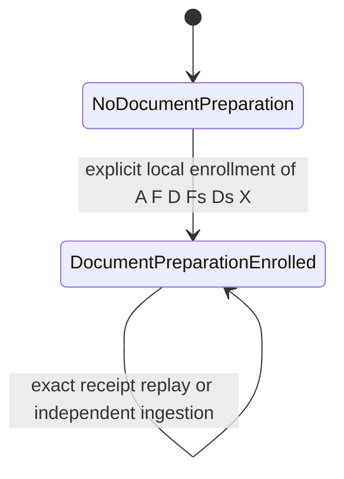

# M8 S3c: document ownership preparation gate

Status: **design only; preparation enrollment recommended**. No document retrieval
owner, projection, indexing or publication is implemented or authorized by this document.
The smallest next slice is an immutable, explicitly authorized association with a named
stored extraction. The retrieval owner remains `legacy`, epoch 1.

Baseline verified locally: signed S3b
`8d2048ea8e65673f535f8a6df0128d25c8d14af3`, branch
`feat/m8-s3b-legacy-enrollment`, worktree `/tmp/mindspace-m8-s3b`, initially clean.
Its parents are signed design `0ab10f4332a0f21924c7f4cb51056acb95ff72dd` and signed S3
`a60e7c118d90097e56972bc4ec1957a8e7b8d245`. Local `main`/`origin/main` remain
`92f68ff`; no remote freshness claim or fetch. Existing branches/worktrees are preserved.

Read with [S3a](m8-s3a-retrieval-ownership.md), the accepted
[S3b contract](m8-s3b-ownership-core-plan.md), and its
[implementation report](m8-s3b-ownership-core.md). S3a's broad cross-kind states and
P1a are deferred alternatives, not the implemented schema. This plan adds a bounded
preparation stage after S3b; it does not expand S3b's successful receipts or transitions.
**Observed** means inspected baseline code or an executed check below; **Proposed**
means a future implementation requirement; **Deferred** means outside the first slice.

## 1. Evidence and the boundary it establishes

| Observed source | Consequence |
| --- | --- |
| [Migration 0013](../migrations/0013_legacy_ownership.sql), `asset_ownership`, receipt/history triggers | Owner is CHECK `legacy`, epoch CHECK 1; rows are immutable. Existing F enrollment must remain unchanged. Rebuilding this table to allow a document owner would prematurely widen the state machine. |
| [Ownership storage](../src/storage/sqlite/ownership.rs), `PermitScope`, `register_context`, `ownership_enroll` | Ordinary M6 write authority cannot authorize enrollment. The validated transaction-private permit, receipt-first retry and same-transaction history are reusable patterns, not transferable S3b permission for a new action. |
| [Administrative CLI](../src/cli/ownership.rs), `AdminContext`; storage `recognize_before_write` | Explicit existing database, OS-account attribution, protected local target and physical DB binding already exist. Reuse this exact boundary, including journal/WAL refusal and fail-closed unsupported contexts. |
| [Migration 0002](../migrations/0002_source_lifecycle.sql), [SQLite storage](../src/storage/sqlite.rs), `ensure_version` | F is a logical file; Fs is its content version. Source versions are unique by `(logical_id,content_hash)`. Reversion reuses old rows. There is no authoritative current source-version pointer. |
| [Document storage](../src/storage/sqlite/documents.rs), `record_inner`, `find_existing`; [0010](../migrations/0010_documents.sql) | D is a separate `document` logical source at a location; Ds is canonical text; X is an original-bytes/detector/extractor/parameters identity. F and D at one path are distinct. No selected document head exists. |
| [Legacy observation](../src/ingest/mod.rs), `observe_bytes`; [document extraction](../src/ingest/document/mod.rs), `extract_document_bytes` | Fs hashes original UTF-8 bytes. Ds hashes canonical text, which may omit a BOM. Fs hash must be compared with X's original-bytes hash, not necessarily Ds's canonical hash. |
| [0012](../migrations/0012_doc_chunks.sql), `chunks_present` in document storage, [chunker](../src/ingest/document/chunk.rs) | C is keyed by `(extraction_id,version,budget_identity)`, with plan hash and immutable ordered chunks. Completion-marker existence alone does not prove complete rows, exact citations or token safety. |
| [TokenBudget](../src/embeddings/budget.rs), [runtime](../src/embeddings/runtime.rs) | Only `embed_document_validated` uses the complete pinned encoding and rejects over-budget documents. Generic legacy embedding can truncate; preparation must not call it. |
| [Indexer](../src/indexing/mod.rs), `index_assertions`; [semantic resolver](../src/retrieval/semantic.rs) | The current assertion indexer adds `subject: ` and uses generic embedding; semantic readiness selects one legacy payload key. Existing indexing cannot be reused unchanged for document publication. |
| SQLite `FILE_PRODUCER_FAMILY`, `reconcile_logical`, `build_search_filters`; [retrieval](../src/retrieval/mod.rs) | Family is `file:legacy`; reconciliation is logical-ID/family scoped. Search eligibility follows memory episodes and spaces, without ownership joins. Association metadata neither hides nor reconciles F's results. |
| SQLite `record_observation_tx`; [M6 ADR](adr-m6-temporal-recording.md), [0008](../migrations/0008_temporal_recording.sql) | Directory moves/absence concern kind `file`, not D. Absence preserves knowledge. Existing `.at(T)` filters episode timestamps with current memberships/indexes; it is not recorded-revision reconstruction. |
| SQLite `MigrationRevisionScope`, `run_migrations`, `WriteTransaction` | Migration 13 demonstrates atomic metadata cutover with R_meta, explicit FK validation and conservative commit outcomes. Extend that protocol, not raw DDL plus an unclassified COMMIT. |

One physical Markdown path currently yields F/Fs through legacy ingestion and D/Ds/X/C
through explicit S3 ingestion. Only F creates evidence/assertions/memories and retrieval
entries. S3b then explicitly enrolls F as asset A. There is no authoritative F–D relation.
S3c must record that relation as a new deliberate administrative decision, without changing
either ingestion pipeline's interpretation of the path.

## 2. Selected model and exact meaning of identity

Require **prior S3b enrollment**. Do not combine unmanaged-file adoption and document
association. The one supported new transition is:

```text
LegacyEnrolled(A,F,legacy,1) + NoDocumentPreparation(A,D)
    -- explicit local prepare-document enrollment -->
LegacyEnrolled(A,F,legacy,1) + DocumentPreparationEnrolled(A,D,Fs,Ds,X)
```

The second coordinate is preparation metadata, **not** ownership by `document`.
Its successful operation records one immutable birth. No current/latest candidate,
mutable head, selected chunk set, index readiness, document-active state or ownership
epoch increment is representable. One A may enroll one D; one D may enroll one A.
Rebinding, release, deactivation and deletion of that association are unsupported.
This deliberately makes the first transition monotone and independently testable.

Distinguish these identities:

| Symbol | Meaning and binding |
| --- | --- |
| P | Physical file observed through an authorized path. A path, device/inode or matching bytes is an observation, not an enduring identity or authorization. This operation does not open P or claim that it still exists. |
| F / Fs | Exact existing legacy logical UUID / explicitly named stored file source-version UUID. F must belong to A's immutable S3b enrollment; Fs must belong to F. |
| A | S3b asset UUID, legacy owner at epoch 1, with its original enrollment operation and birth R. This is the association authority's database target, not a path claim. |
| D / Ds | Exact existing document logical UUID / named canonical source-version UUID. Ds must belong to D; F and D must differ. |
| X | Exact extraction UUID belonging to D and Ds, original byte hash/size, detector version, extractor ID/version, parameters hash and structure hash/count. |
| C | Exact chunk-set key and plan hash, introduced only by a later indexing candidate. It is absent from first-slice storage and intent. |

The administrator explicitly attests that the selected F and D are the intended
representations of this asset. Require `Fs.content_hash = X.source_bytes_hash` and verify
the stored Fs content's actual hash/byte length; verify Ds content against its hash and
X's declared canonical source. These are consistency checks between selected stored
versions, **not proof of physical-file continuity or operator authority**. A BOM may make
`Fs.content_hash != Ds.content_hash`; CRLF and all canonical bytes must remain exact.
If the selected legacy version is unavailable or differs from X's original bytes, refuse;
do not infer a replacement or update legacy ingestion on the operator's behalf.

Same location is neither necessary nor sufficient: a deliberately selected stored
snapshot may survive relocation. Display both current logical locators and immutable
version locations, escaping controls/bidi. Equal paths/hashes never auto-associate
copies, merge logical IDs or resolve conflicting associations. A wrong explicit same-byte
association is possible under Model A; preview and confirmation expose the exact IDs,
but cannot independently prove the administrator's intent about physical continuity.

Counterexample: legacy observations A→B→A reuse the original Fs(A); document extraction
timestamps can still make B appear newest. Copies of A also share its hash. Selecting
`MAX(ingested_at)`, a matching filename or active assertions' source IDs would invent a
current head. This plan instead names Fs/Ds/X and calls the result a stored snapshot.

## 3. Authority and immutable intent

Preserve **Model A** for this preparation operation: the database-owning local OS
account, administrative process, application, kernel/local storage and SQLite are
trusted. Same-UID malicious processes are outside the boundary; no distinct-human
authentication, generic IAM, delegation, broker grant, asynchronous revocation or
portable DB authority is claimed. Enrollment grants no filesystem access.

Proposed direct CLI only (names are not implemented):

```text
mind --db /absolute/existing/mind.db ownership enroll-document-preparation \
  --asset-id A --legacy-source-version Fs --document-id D \
  --document-source-version Ds --extraction-id X --expected-revision R \
  --nonce UUID --json
mind --db /absolute/existing/mind.db ownership enroll-document-preparation \
  --asset-id A --legacy-source-version Fs --document-id D \
  --document-source-version Ds --extraction-id X --expected-revision R \
  --operation-id FULL_ID --apply --confirm-intent DIGEST --json
```

No MCP tool/opcode, public Store mutation, worker/broker route, ingestion call, imported
document approval or metadata edit may construct the private administrative context.
Reuse S3b's existing-only explicit command-line DB policy; never use default/env selection,
create a missing database or weaken symlink/hardlink/permissions/filesystem checks.
Kernel-derived real/effective UID and GID must satisfy the existing policy. Retain and
revalidate physical `(canonical DB path,dev,ino)` and context through COMMIT. Preserve
non-writing recognition before RW opening, foreign/empty/journal refusals, WAL/SHM policy
and the stable protected-directory assumption. Ordinary schema migration may install
empty metadata even if later enrollment refuses; it cannot enroll anything.

Define a new canonical domain `mindspace.s3c.local-document-preparation@1`, action
`enroll_document_preparation@1`, and full operation ID
`local-doc-prepare@1:<nonce>:<sha256(canonical_request)>`. Do not reinterpret a S3b ID,
receipt, private permit or confirmed digest as this new action. The canonical encoding
must bind, in fixed order:

1. Domain/version and nonce; physical DB tuple; `local-os-account@1` and kernel UID.
2. A, F, S3b enrollment operation/birth R, unchanged owner=`legacy` and epoch=1.
3. Exact Fs, D, Ds and X; stored content hashes/lengths and the full X identity above,
   including format/text-is-source and structure identity.
4. Deterministic F and D logical base fingerprints: ID, kind, present/absent state,
   tagged nullable location, created-at and required NULL Git identity. Exact selected
   source-version/provenance fields are included in the snapshot fingerprint.
5. Expected global recording R, expected `NoDocumentPreparation`, intended
   `DocumentPreparationEnrolled`, and the action. No unspecified transition fields.

Use S3b's length-prefixed UTF-8, canonical UUID bytes, fixed-width integers, tagged
nulls and signed-i64 timestamp convention; reject overflow, extra/unsupported fields,
noncanonical IDs and requests over 64 KiB. No normalization, lossy display labels or
ambiguous JSON hash. Define a versioned snapshot digest over the immutable selected
source/extraction tuple; locators used as base checks do not establish authority.

A read-only preview shows every binding and the exact digest. Apply confirms precisely
that intent. A full ID binds bytes; it is not a signature or transferable approval.
A bare nonce has no durable precommit authority. Within this action domain committed
nonce reuse conflicts. S3b and S3c IDs/nonces are domain separated, never interchangeable.
Only SQL COMMIT makes successful intent durable. Cancellation before COMMIT is best
effort; there is no external grant with a lifetime to extend or revoke.

## 4. Smallest schema and storage API

**Proposed migration 0014**, subject to version recheck before implementation, is additive.
Leave schema-13 ownership, receipt/history rows and their enforcement intact. Prefer two
new tables; the enrollment row is both the immutable association and its initial snapshot,
so a separate mutable association/head/history framework is unnecessary.

| New table | Required columns and constraints |
| --- | --- |
| `document_preparation_enrollments` | A PK; F; unique NOT NULL D; S3b enrollment operation and birth R; exact Fs/Ds/X FKs; snapshot digest; operation ID UNIQUE; created R FK; state CHECK `document_preparation_enrolled`. Composite FK to existing `asset_ownership(asset_id,source_id,operation_id,created_revision)` binds A/F and the actual S3b enrollment. This uses its existing unique key. |
| `document_preparation_receipts` | Full operation ID PK; UNIQUE committed nonce; canonical request BLOB ≤64 KiB, version CHECK 1 and digest; physical DB tuple/account attribution; action/expected/intended state CHECKs for the sole transition; expected R; exact A/F/D/Fs/Ds/X/snapshot digest; committed R FK and CHECK `committed_R=expected_R+1`. A UNIQUE so a new ID cannot enroll an already-associated A again. |

All listed IDs, enum tags, digests, request bytes, identity/account fields and revisions
are explicitly **NOT NULL**, including primary/composite keys. Do not rely on SQLite's
ordinary TEXT PRIMARY KEY to reject NULL, or allow a NULL component to bypass a composite
FK. Revisions must be positive checked integers; blobs and digest/ID encodings must have
explicit type/length checks. There are no optional relationship or readiness fields.

Use matching UNIQUE composite keys and deferred circular FKs between the two new rows
over `(A,F,D,Fs,Ds,X,snapshot_digest,operation_id,committed_R)`, with the enrollment's
created R as committed R. This enforces receipt-to-result identity and same-R birth,
rather than relying on matching nullable operation strings. Check full ID structure,
digest encoding and constant action/state/actor tags. Hash/canonical-request verification
is performed by the validated receiver and exact private SQL permit; SQLite does not
magically authenticate SHA-256 or an OS account.

SQL insertion triggers must independently join existing rows and enforce:

- A/F is an existing schema-13 legacy/epoch-1 enrollment with its actual receipt/history;
  F is `file`, D is `document`, IDs differ, Git-only identity fields are NULL.
- Fs belongs to F and has kind `file`; Ds belongs to D and has kind `document`;
  X belongs to D/Ds. Fs original hash matches X source-bytes hash, not Ds hash.
- Every new row/availability birth uses the current M6 R and an **action-specific private
  validated permit** covering all values. S3b permission and generic M6 permission refuse.
  Automatic receipt/enrollment availability births stay in the same transaction.
- All new control rows reject UPDATE/DELETE. BEFORE INSERT must also refuse replacement
  of an existing PK/unique association, even with a matching permit; do not rely on DELETE
  triggers to catch `INSERT OR REPLACE` with recursive triggers disabled. Conflict-ignore
  cannot be reported as success without validating the original exact receipt.

Protect the referenced evidence from identity substitution. New targeted guards cover
both UPDATE and BEFORE INSERT/REPLACE for enrolled D's kind/Git identity and pinned
Fs/Ds/X IDs. Existing rows cannot be replaced with new content, extraction identity or
provenance under the same ID. Refuse deletion through FKs/guards. Freeze X's node set
against late insertions and REPLACE once pinned, in addition to existing append-only
UPDATE/DELETE rules; verify its structure hash/count before first enrollment. Normal
ingestion of a new version/extraction remains allowed and does not update these pins.
Ordinary presence/location changes remain allowed. Do not fence unrelated document
rows or forbid original-byte blob erasure. Test guards with recursive triggers off/on.

The row's birth plus immutable availability is its complete first-slice history. No
mutable current row requires repeated history snapshots yet. Use an immutable versioned
schema marker in `m6_row_availability`, analogous to schema 13, and extend enforcement
inventory to every new guard/marker. Do not introduce an unknown public temporal coverage
dimension or claim M6 query reconstruction. Referenced X existed by enrollment R;
its true earlier recorded birth may be unknown, since S1/S3 side tables lack full coverage.

Proposed private APIs: `preview_document_preparation`,
`enroll_document_preparation`, and `lookup_document_preparation_receipt`, with explicit
typed `DocumentPreparationIntent`, `DocumentPreparationReceipt` and a nonclone,
transaction-scoped action permit. Only direct CLI composition may authorize mutation.
Read-only diagnostic methods may inspect pins; none may infer a head or mutate readiness.
No production test hooks, caller booleans or configurable SQL functions issue permission.

## 5. Transaction, concurrency and recovery

1. Establish the existing Model-A local context and recognized existing DB. Parse the
   full operation ID and supplied bindings. Look up its receipt before reconstructing
   current source/base/R. Validate its stored canonical request/digest, caller's exact
   A/Fs/D/Ds/X/expected R, action, physical DB and actor. Exact committed replay returns
   the original result, even if subsequent ingestion changes the source metadata.
2. A missing receipt means `NotObserved`, never process death or rollback. Require a
   fresh explicit apply/confirmation for an attempt. Acquire `BEGIN IMMEDIATE` through
   the normal recording transaction and recheck the receipt **first**. A race winner's
   exact receipt returns successfully after rolling back the unused allocated R.
3. For a new write, reject nonce/association conflicts, then check expected global R
   against the pre-allocation R. Reconstruct all canonical bindings and verify full-ID
   equality, expected unassociated A/D, legacy epoch/receipt, source/base hashes and
   joins. Both already-associated A and D conflict, including the same snapshot under
   a different operation ID. Return `AlreadyEnrolled`/conflict, not a fabricated receipt
   for the new operation. Do not silently rebase a stale intent.
4. Arm the exact private permit only after validation. Insert enrollment, receipt and
   immutable availability under that R. Validate same-R/result/FKs, revalidate local
   target/context, and commit via the existing `WriteTransaction` outcome machinery.
   No source/session/observation/evidence/assertion/memory/space/FTS/vector mutations.
5. Clear permission on every exit/panic. Known precommit/refusal or definitive noncommit
   rolls back this attempt's rows and R. Ambiguous COMMIT, lost acknowledgement or
   output failure after commitment must not be labelled rollback. Use
   `CommitOutcomeUnknown` when durability cannot be established and permanently discard
   uncertain administrative handles; resolve on a healthy reopened original target.

Two contenders for A or D serialize. Uniqueness, exact base/R and the one-way association
allow one effect. A paused pre-BEGIN writer must repeat receipt/state/R checks after a
retry wins; a writer already inside BEGIN holds SQLite's lock until completion/recovery.
A later attempt cannot use a stale read-only absence result to skip checks. Missing
receipt under the acquired writer means only no committed matching operation at that
barrier, not proof that a paused old process has terminated. That process is logically
fenced when it next checks. Busy/locked/uninspectable/corrupt/replaced DB is not evidence
of noncommit. No separate lockfile, exactly-once execution or lease-expiry claim.

| Interruption / retry | Required result |
| --- | --- |
| Before BEGIN, or rollback after staged rows | No successful receipt for this attempt; exact freshly invoked retry may attempt unchanged intent under all checks. |
| COMMIT veto / known definitive COMMIT failure | NoCommit for this attempt; no association, receipt or committed R. |
| Durable COMMIT but output lost | Original receipt resolves after restart; exact replay spends no R and never repeats effects. |
| COMMIT I/O outcome uncertain | UNKNOWN until healthy original DB/serialization/receipt inspection resolves it; never infer rollback from absent output or a timeout. |
| Exact receipt exists after source change | Return original historical enrollment/R, not a fresh currentness/readiness assertion. |
| Different parameters under same full ID | Conflict before or after commitment; no authority expansion. |
| Same nonce/new digest after success | Conflict within the S3c action domain. Before commitment it is a different full intent needing fresh confirmation. |
| DB clone/restore/move or unsafe sidecars | Refuse rebinding; original stable-target recovery is separate administration. Journal or WAL-without-SHM may require trusted SQLite recovery first, as in S3b. |

## 6. Lifecycle without implicit selection



Every state retains `LegacyEnrolled(legacy,1)` and existing retrieval. Independent
ingestion is not an enrollment mutation; the self-edge denotes unchanged metadata.
No outgoing owner transfer/deactivation/rebind edge is supported in this first slice.

| Event | Preparation metadata and retrieval |
| --- | --- |
| First S3 ingestion or repeat, before/after S3b | Derive/store only, no enrollment. Unmanaged F is refused by this new command until separately enrolled through S3b. Document-only assets are deferred. |
| Explicit enrollment | Pin the named existing Fs/Ds/X once. Legacy IDs, episodes, memberships and indexes remain unchanged. No automatic document projection. |
| Changed/re-ingested document | New Ds/X may exist; old enrollment remains the named historical snapshot. No freshness or selected-current flag is updated. New versions are candidates only when a later explicit stage-2 operation selects them. |
| Reversion / extractor or parameter change | Reuse or create immutable underlying versions as today. Exact original retry returns its old receipt; a different enrollment intent conflicts. Future explicit candidate selection may name a new X or exact prior X, without reviving an old publication. |
| Chunker/tokenizer change | New C can coexist, but neither becomes selected. Enrollment contains no C or readiness claim. Stage 2 names its own exact version and validates it. |
| Missing, incomplete, stale or incompatible C | Does not block metadata-only enrollment of a valid X. Report only `not_evaluated` for indexing, never ready. Stage 2 must refuse a missing/corrupt/wrong-version set; no “latest C” fallback or derivation hidden inside enrollment. |
| F move or directory absence | Preserve existing F lifecycle/legacy search; D is not automatically moved or absented. Association survives as an explicit stored relationship, without asserting matching current locators. |
| File deletion, permission denial or path replacement | No inference by this operation. Retained canonical evidence remains resolvable. Later live checks must distinguish changed/missing/unavailable. A path replacement does not acquire the existing association. |
| Original-byte blob erasure | Existing shared-hash erasure semantics remain unchanged; Fs/Ds canonical contents and X pins are retained. Not full text erasure or deactivation. Historical receipt does not promise original bytes are retrievable now. |
| Administrator selected wrong association | No ordinary edit/DELETE/undo. Report the mistake; a separately reviewed explicit compensation/reassociation design is required. Legacy retrieval stays active, so preparation cannot silently remove knowledge. |

“Stale” is not an automatically maintained storage state. Without an authoritative current
document head/observation, the system cannot prove that the initial X is the newest or
live-file-current. Diagnostic differences are observations, not authority. Any later
publication must obtain a fresh authorized candidate/base and establish its own current
selection/observation policy; it cannot cite this enrollment receipt as ongoing approval.
No filesystem/SQLite transaction can promise that live bytes never change after a check.

## 7. Four independent implementation stages

| Stage | Bounded deliverable | Gate before proceeding |
| --- | --- | --- |
| 1: metadata and enrollment (smallest next slice) | Proposed 0014, direct admin preview/apply, one immutable A–D association and initial Fs/Ds/X pins, successful receipts, recovery and SQL guards. No C, indexes, ordinary document assertions or visibility fields. | All stage-1 tests below; prior S3b behavior and all retrieval unchanged. No tokenizer/model installation/inference needed; no-embeddings build works. |
| 2: token-safe indexing and citation validation | Separately authorized immutable candidate referencing the association and an explicitly selected Ds/X/C. New versions do not overwrite stage-1 pins. Validate complete source coverage, exact citations and source-only strict payloads; bounded unpublished derived vectors/readiness outside ordinary assertion/search tables. | Separate schema/action/expected-state and resource contract, complete strict routing including future rebuild/backfill, vector key policy and corruption tests. No active search or selected publication head. |
| 3: atomic publication and visibility transfer | Explicit owner/head/epoch lifecycle, all legacy writer/path/move/absence fences, provenance-sensitive projection, membership policy, FTS/vector eligibility/readiness and one-snapshot readers. Retire F/create D episodes in the same transaction. | Publication and visibility invariants must ship together. No document result appears before this gate. Review its authority model independently; S3c's Model A authorizes preparation only, not S3a's deferred stronger publication authority. |
| 4: recorded-revision historical retrieval | Explicit recorded-R reconstruction from availability and ownership/episode/membership histories with declared ranking policy. | Preserve `.at(T)`; fail unsupported coverage/ranking requests. This remains required before claiming complete temporal projection, even if stage-3 internals are separately tested. |

Stage 2 must use `(X,chunker_version,budget_identity,plan_hash)`, ordered exact chunk IDs,
source/canonical hashes and full S1 anchors. Recompute/verify chunk count, plan/identity,
UTF-8 endpoints, contiguous unique `[0,len(canonical_text))` coverage and source slice
equality; empty text has an explicit zero-chunk completed set. Preserve whitespace/CRLF
and distinguish skipped whitespace in a later projection manifest. S1 resolution must
return the exact named revision/extraction; changing source bytes never retargets anchors.

For the currently supported Nomic configuration, validate the entire actual payload
with the pinned tokenizer, document prefix and special tokens included, limit **2048**,
padding/truncation disabled. Send only the exact canonical slice through
`CandleRuntime::embed_document_validated`; do not concatenate section labels or call the
generic `EmbeddingRuntime::embed_document` as fallback. Structural context is metadata.
A source slice at 2048 may exceed budget after a `subject: ` prefix. A new payload/model
policy requires new keys and validation; stale sets must fail/rechunk explicitly.
The first metadata slice neither tests nor promises successful embedding.

Do not stage ordinary assertions and assume no memories makes all indexing harmless:
the current indexer scans assertions including historical ones. Stage 2 needs isolated
unpublished artifacts or a separately proved routing exclusion. Required vectors failing
must preserve F. Stage 3 additionally needs producer reconciliation across F/D, exact
assertion-to-chunk provenance, space mapping without widening, all-write-path fencing,
candidate eligibility before limits, compatible vector payload groups and shared citation
enrichment across lexical/semantic/hybrid. These are substantive remaining blockers,
not implied features of an association row.

## 8. Migration, rollback and compatibility contract

Upgrade populated real schema 13 additively. Use `MigrationRevisionScope` in the runner's
existing `BEGIN IMMEDIATE`, not nested `begin_write`. Generalize its current version-13
branch narrowly to include the new metadata version; preserve original M6 baseline and
all S3b markers/history. DDL, new enforcement, migration registration, schema marker and
one R_meta commit atomically. Explicitly run FK/inventory validation while migration FKs
are disabled, restore settings on every exit and classify postcommit errors UNKNOWN.
No association/backfill/adoption is inferred from paths or existing document rows.

Repeated open/migration allocates no second R_meta. Older binaries reject schema 14.
Known uncommitted failure preserves exact schema-13 data/registration/R. Lost ACK requires
healthy reopen and registration inspection; a committed upgrade is not rolled back by an
ordinary error return. Downgrade/backup restore is separate explicit operator recovery,
not destructive DOWN SQL. A committed association cannot be removed to make a retry pass.

Enrollment may add only its new control/availability rows and one recording R. Snapshot
pre-existing tables, including ownership/receipts/history, sources/observations/events,
evidence/assertions/memories, memberships, FTS and vectors. They must compare exactly
before/after enrollment and failed attempts. Legacy file/directory/Git ingestion and
default MCP definitions remain unchanged; ordinary moves, absence, supersession, manual
memory changes and timestamp search retain their current semantics. No location reservation
is introduced, because that would require changing legacy writers before publication.

## 9. Executable acceptance matrix

These are **future tests**, not currently passing S3c APIs. Implement stage 1 in
`tests/document_preparation_admin.rs`, storage-private SQL units and migration tests,
using disposable real databases and actual CLI processes. Keep fault/barrier hooks
test-only; validate a production binary ignores hook environment and exposes no hook
markers. Each case checks durable rows/R, `foreign_key_check`/`integrity_check`, and
unchanged legacy state/search; do not accept a message-only oracle.

| ID / proposed test | Required executable oracle | Stage |
| --- | --- | --- |
| E1 `explicit_admin_enrollment_pins_one_extraction` | Legacy ingest→S3b enroll→S3 derive→preview/apply. Verify exact A/F/D/Fs/Ds/X/digest/R joins and one receipt; active legacy IDs/FTS/vector bytes unchanged. Both ingestion orders work. | 1 |
| E2 `context_target_and_action_refuse` | Missing/empty/foreign DB, env/default DB, final symlink/hardlink/unsafe ancestor/sidecar, wrong UID context, replaced DB and S3b full ID all refuse without enrollment. Never initialize a missing target. Reuse real process policy tests. | 1 |
| E3 `explicit_stored_identity_required` | Unmanaged/missing A, wrong F/Fs/D/Ds/X, wrong kind/Git identity, Fs hash mismatch and corrupt stored content/structure refuse. A path or metadata principal cannot replace a full ID. | 1 |
| E4 `bom_original_and_canonical_hashes_differ` | Enroll matching original-byte Fs/X with BOM-stripped Ds; CRLF/Unicode/CJK/combining/control/bidi bytes remain exact. Copies/same-path distinct IDs never auto-associate. Preview escaping cannot alter canonical intent. | 1 |
| E5 `metadata_and_mcp_cannot_enroll` | Generic M6 transaction, `set_meta`, ingestion, S3b permit and real MCP unknown-tool requests cannot write new records. Default tool list is byte-equivalent before/after. Same-UID arbitrary shell resistance is not an asserted test. | 1 |
| R1 `exact_replay_returns_original_after_changes` | Repeat with original full bindings after changed locations, absent F, new/reverted Ds/X and missing model. Return original receipt/R, no new revision; altered params conflict even before a first success. | 1 |
| R2 `new_intent_and_reused_nonce_conflict` | Same A/D/snapshot with different ID, same A/different D, same D/different A, or committed nonce/new digest refuses. No second receipt and no partial association; wrong expected R/state never rebases. | 1 |
| C1 `six_process_publication_free_enrollment` | Six exact retries have one durable birth; six conflicting A/D intents yield one winner. Repeat release runs; compare complete legacy results/state. | 1 |
| C2 `paused_writer_rechecks_after_winner` | Barrier before BEGIN; retry wins; resume old process, which returns exact receipt or conflicts appropriately. Hold a live writer across another process's read absence; busy never means rollback. | 1 |
| F1 `rollback_and_commit_veto_are_atomic` | Fail after each new row/availability insertion and veto COMMIT. No new rows/R; permit cleared and pre-existing data unchanged. | 1 |
| F2 `lost_ack_restart_and_kill_recover` | Kill before BEGIN, after BEGIN/writes, around COMMIT and after durable COMMIT before output; reopen exact retry. One receipt or safe attempt, never duplicate; ambiguous output remains UNKNOWN. Preserve S3b journal/WAL recovery limitations. | 1 |
| S1 `sql_states_and_replacements_refuse` | Raw supported connection with/without M6 and matching test-only permit: wrong state/action/epoch/owner/joins/R, UPDATE/DELETE/UPSERT/REPLACE and changed pinned Fs/Ds/X/node identities refuse. Test recursive triggers off/on and new-node injection. | 1 |
| S2 `document_owner_and_publication_unrepresentable` | Owner remains CHECK legacy/1; reject attempted document owner/epoch2. No publication/head/index columns/API, and no document evidence/assertion/memory/FTS/vector rows appear. New preparation state is never interpreted as retrieval ownership. | 1 |
| M1 `populated_thirteen_upgrade_preserves_legacy` | Construct real schema-13 DB with legacy memories, S3b receipt/history, documents, FTS/vectors/spaces. Upgrade actual proposed migration: exactly one R_meta, empty preparation tables, unchanged original baseline/capabilities/data/search. Also test real 11→12→13→14 path. | 1 |
| M2 `migration_failure_unknown_and_inventory` | Late DDL/FK failure, commit veto, lost ACK, restart, competing installers and dropped trigger/marker. Known failure keeps old schema; committed unknown reopens once; missing enforcement refuses open. | 1 |
| L1 `ingestion_never_refreshes_enrollment` | Changed/reverted bytes, extractor/chunker versions, F move/absence, deletion/path reuse and blob erasure never mutate pins or hide legacy. No C, empty C and corrupt C do not become readiness. Compare all existing retrieval modes and timestamp queries. | 1 |
| K1 `legacy_and_no_embeddings_compatibility` | Existing lifecycle, retrieval, temporal, directory/Git, ownership and MCP suites pass; no-default-features build and actual metadata enrollment work without tokenizer/weights. Production contains no test hook. | 1 |
| I1 `complete_exact_candidate_and_budget` | Missing/incomplete/wrong X/C/plan, shifted anchor, token-policy change, 2047/2048/2049 inputs and fabricated context reject or validate precisely. Every slice/citation/count checked; sentinel legacy embedding panics if reached for a doc. | 2 |
| I2 `unpublished_index_failure_has_no_visibility` | Nth embedding failure, wrong payload keys, rebuild/backfill and clear/model-change leave F visible; no ordinary staged assertion/index leak; bounds measured. | 2 |
| P1 `atomic_transfer_and_all_writer_fences` | One-snapshot lexical/semantic/hybrid readers see old or new; all direct/broker directory/move/absence writers fenced; spaces don't widen; late failure/unknown/retry preserve atomic episode transfer. Publication requires separate explicit authority. | 3 |
| T1 `recorded_revision_is_not_timestamp` | Equal/backward timestamps, membership/source updates, deactivation/reversion and unsupported historical ranking. Recorded-R reconstructs exact eligible history; existing `.at(T)` unchanged. | 4 |

Stage-1 mutation targets: remove inner receipt lookup, expected-R check, private permit,
unique D or REPLACE guard, or original-byte join. Tests must kill each semantic mutant
after verified recompilation. Do not claim later index/transfer tests pass because
publication fields or endpoints are absent. Full implementation verification requires
fmt, locked Clippy/all-targets, full locked suite, targeted release/concurrency/fault
tests and no-embeddings compatibility on its final source tree.

## 10. Alternatives, risks and disposition

Rejected for this first slice:

- Extending schema-13 owner to `document` or rebuilding immutable S3b rows: creates owner
  transitions before publication/visibility can be enforced and reinterprets old receipts.
- P1a path reservations/tombstones or combined F/D adoption: broader writer/lifecycle
  policy; not required for nonpublishing enrollment and would change legacy behavior.
- Automatically associating equal paths/hashes or choosing newest extraction: mistakes
  observations for identity/authority and fails copies/reversion.
- Storing optional C/readiness/head in stage 1: nullable/incomplete candidates add states
  without proving indexing. Stage 2 must own exact candidate selection and validation.
- Supporting repeated snapshot replacement or reassociation now: needs extra actions,
  state/history/CAS/undo rules; the one-time association plus birth is sufficient now.
- Generic principal infrastructure: not needed under this explicitly selected local
  boundary; still needed if a later feature requires Model B's excluded guarantees.

Remaining risks/assumptions: Model A trusts local account/process and stable protected
storage; byte consistency cannot authenticate physical lineage. Administrator mistakes
have no first-slice undo. Snapshot pins add retention constraints on source/X/structure
rows, not an original-byte retention promise. Later candidates must handle new versions
explicitly; no automatic live freshness exists. New SQL guards, migration, receipt codec
and failure classification still require implementation and adversarial evidence.
Bulk enrollment/resource costs are unmeasured; first slice accepts one constant-size
intent at a time, reuses the 64-KiB request bound and existing extraction size/node limits,
and must avoid per-node copies of full canonical text during validation.

Publication remains blocked on selected-head/lifecycle policy, all-entry legacy fences,
strict unpublished indexing, provenance-sensitive assertion mapping, membership consent,
single-snapshot readers, cross-mode citations and a separately selected publication
authority contract. Recorded-R query reconstruction remains unimplemented. These are
explicit gates for later stages, not blockers to independently testing stage-1 metadata.

## 11. Verification of this design gate

Current executed baseline checks (not tests of proposed S3c APIs): six locked/offline
release suites, `document_chunks`, `document_ingest`, `document_model`, `lifecycle`,
`m6_temporal`, `retrieval`: **137 passed, 0 failed, 2 ignored**. Log:
`/tmp/m8-s3c-existing-baseline-tests.log`. They establish current revision/citation,
rollback, legacy lifecycle and retrieval behavior; they do not implement this plan.
The separate existing release `token_budget` suite passed **5/0/1**, including the
complete prefix/special-token count and strict overflow refusal before weights load;
`/tmp/m8-s3c-tokenizer-baseline-tests.log`. Combined current targeted result:
**142 passed, 0 failed, 3 ignored**. The ignored inference/performance cases were not run.
The S3b full-suite **1063/0/8** is the preceding report, not a new full run here.
No full suite, Clippy, production build, S3c migration or proposed enrollment test is
claimed for a documentation-only gate. Final document-link/fence/whitespace/scope checks
and independent read-only design review are recorded in the handoff.

**ACCEPT for preparation-only design**, conditional on Model A and the explicit future
implementation gates. The subsequent implementation task rechecked this complete plan
against S3b and accepted the one-time association boundary. Its reference to chunk-version
validation is governed by this plan: stage 1 has no C selection or readiness; exact chunk
validation belongs to stage 2. No blocking contradiction was found. This documentation
may be committed locally before creating an isolated implementation worktree. No runtime
schema, enrollment, ingestion, MCP, indexing or retrieval changes accompany the design
commit; no merge, push or S4. Implementation must pass its own gates and remain uncommitted
for review.
