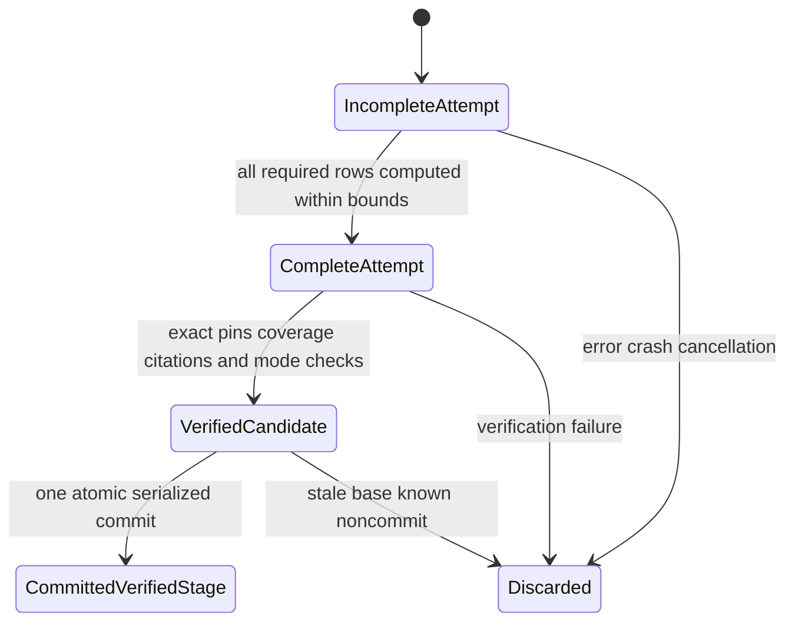

# M8 S3d: isolated staged indexes and exact citations

Status: **design and feasibility gate only**. Recommend isolated, immutable lexical
staging/citation artifacts, followed by an optional strict semantic component. Neither
component enters active retrieval or changes ownership. No implementation or migration
is delivered by this document.

Baseline verified: signed S3c `4c5d6ba28ddb3621f0cd81c084c98e0a134a8733`, branch
`feat/m8-s3c-document-preparation`, worktree `/tmp/mindspace-m8-s3c`, initially clean.
Its signed design parent is `ae4b1c9cfdfaceaf38cde6ce392118a57e130e7b`.
Local `main`/`origin/main` remain `92f68ff`; no remote freshness claim or fetch.
Read with [S3c plan](m8-s3c-document-ownership-plan.md),
[S3c report](m8-s3c-document-ownership.md), [S3a](m8-s3a-retrieval-ownership.md),
[S3b authority](m8-s3b-ownership-core-plan.md) and [S3 token/chunk contract](m8-s3-chunking.md).
Observed source and executed experiments are labelled below. All new tables, APIs,
actions, states and tests are **proposed**, not implemented.

## 1. Actual data flow and exposure boundary

| Observed source | Consequence |
| --- | --- |
| [Document storage](../src/storage/sqlite/documents.rs), `record_inner`; [0010](../migrations/0010_documents.sql) | D is a document logical UUID; Ds holds immutable canonical text; X binds D/Ds, original-byte hash, detector/extractor/version/parameters and structure. Canonical and original bytes can differ, including BOM removal. |
| [0012](../migrations/0012_doc_chunks.sql), `record_with_chunks`, `chunks_present`, `list_chunks` | C is `(X,chunker_version,budget_identity)` plus `plan_hash`. Completion markers/counts do not independently prove correct content. `list_document_chunks(X)` returns **all** versions/budgets; staging needs an exact-set query, not the first/latest list element. |
| [0014](../migrations/0014_document_preparation.sql), [preparation receiver](../src/storage/sqlite/document_preparation.rs) | S3c enrolls A/F–D and initial Fs/Ds/X, leaving owner legacy/1. Its immutable receipt is not continuing authorization to index arbitrary new revisions. No C/head/readiness exists. |
| [0013](../migrations/0013_legacy_ownership.sql), [CLI](../src/cli/ownership.rs), [S3b storage](../src/storage/sqlite/ownership.rs) | Model A, explicit existing DB and account context, hash-bound full intents, action-private permission, serialized writes and receipt-first recovery are available patterns. Ordinary M6 permission is not administrative authorization. |
| [Assertion creation](../src/storage/sqlite.rs), `get_or_create_assertion` | Creating an ordinary assertion immediately inserts `assertion_fts`, even without a memory episode. |
| SQLite `search`, `search_vectors`, `build_search_filters`; [retrieval](../src/retrieval/mod.rs) | Search joins assertions/evidence/sources to memory episodes/spaces. Shared FTS corpus statistics affect BM25 before eligibility can isolate staged rows. Hybrid merges ordinary assertion/memory identities. |
| [Indexer](../src/indexing/mod.rs), SQLite `list_assertions_needing_embedding` | All assertions, including historical ones, can be indexed. The indexer adds `subject: ` and calls generic embedding. Omitting memories is insufficient isolation. |
| [TokenBudget](../src/embeddings/budget.rs), [runtime](../src/embeddings/runtime.rs) | The explicit strict method rejects overflow using full pinned encoding; generic legacy embedding truncates. TokenBudget itself is unavailable without embedding features. |
| [Embedding descriptor](../src/core/mod.rs), [manifest](../src/embeddings/manifest.rs), [semantic resolver](../src/retrieval/semantic.rs) | Existing vectors require assertion IDs and one legacy pipeline key. The resolver checks existing-vector readiness, verifies all model artifacts, and builds a query runtime. Staging must not reuse that readiness prerequisite or modify its key. |
| SQLite `begin_write`, `WriteTransaction`, `run_migrations`; [M6 ADR](adr-m6-temporal-recording.md) | M6 records transactions/availability; it does not implement recorded-R retrieval. Timestamp `.at(T)` uses episode timestamps with current memberships/indexes. |

Trace one Markdown file: legacy ingestion produces F/Fs, evidence, assertions, FTS and
`file:legacy` episodes; S3 produces separate D/Ds/X/C without memories. S3b enrolls A/F;
S3c explicitly associates A/F with D and its initial snapshot. Search continues to return
legacy episodes. S3d would select a named C and write only separate staging artifacts.

**Actual visibility boundary:** ordinary assertion creation already changes the shared
FTS corpus. A matching active memory episode and space membership then make its content
eligible for default search after COMMIT. A future cross-kind publication must coordinate
all these effects and retire competing F episodes atomically. S3d does none of them.

### Executed shared-FTS counterexample

A disposable in-memory probe linked the checkout's bundled SQLite **3.53.2** and used
the existing `assertion_fts` definition. Query `alpha OR beta` admitted only `legacy-a`
and `legacy-b`. Before inserting 100 hidden `alpha filler` rows, scores/order were:

```text
legacy-a  -0.6157897930329752
legacy-b  -0.5690209479924959
```

Afterwards, with the same eligibility restriction:

```text
legacy-b  -5.297316802132076
legacy-a  -0.00000137121906507791
```

Hidden rows reversed the eligible results. This is observed, not just a hypothetical
filter omission. Orphan FTS rows would additionally fail existing FTS integrity checks;
ordinary staged assertions would also enter generic indexing/status. Separate tables
are required. Probe: `/tmp/m8-s3d-perf-probe.rs`; output:
`/tmp/m8-s3d-perf-results/fts-drift.txt`. No application/user DB was used.

## 2. Decision, authority and selected snapshots

Use **document-specific staging storage**. No ordinary sources/evidence/assertions,
memory episodes/memberships, `assertion_fts`, `assertion_embeddings`, active-model metadata
or ownership rows are created or modified. No default retrieval adapter reads staging.
No query-time hiding flag is used as the isolation boundary.

The smallest next implementation is **lexical staging and exact citations only**.
Optional semantic staging is a separately testable extension referencing a verified
lexical artifact. This avoids nullable readiness fields and copying lexical text for
every model. Neither stage is document publication; S4 is unrelated and remains excluded.

Keep Model A: explicit direct local administrative invocation by the DB-owning OS account,
existing initialized DB and physical path/dev/inode binding, trusted process/application/
SQLite/storage. Reuse S3b's protected-target policy and fail-closed journal/WAL limitations.
No human authentication, hostile same-UID isolation, generic IAM, broker delegation,
external grant lease or asynchronous revocation is claimed. Reading a receipt is not
new permission. No MCP endpoint, ingestion hook or metadata edit can issue a stage permit.

Proposed explicit action `stage_document_lexical@1`, with preview/apply and exact digest
confirmation, binds:

- Existing A/F, its S3b legacy/1 enrollment, D and S3c association operation/birth R.
- Explicit **selected** Fs/Ds/X and C triple/plan hash, canonical/structure/original hashes.
- Lexical/citation/verification policies, deterministic artifact ID, expected global R,
  F/D logical base fingerprints and intended `CreateVerifiedUnpublishedLexicalStage`.
- Physical DB/account, domain/version and nonce. A distinct future
  `stage_document_semantic@1` binds the lexical artifact, exact model/payload descriptor
  and intended semantic artifact instead. No action can be interpreted as publish.

Use the existing strict canonical binary intent conventions and a new domain/full ID,
for example `local-doc-stage-lexical@1:<nonce>:<digest>`. Successful receipts are immutable;
there is no durable precommit approval or unsigned caller-supplied principal. Model and
input selection is explicit, never inherited from a later changed default configuration.

S3c's initial snapshot remains untouched. A later X may be staged only by naming matching
Fs/Ds/X under the **same enrolled F/D**, revalidating the complete tuple and this new
authorization. Fs must already exist and its actual original-byte hash/size must match X;
Ds and X must belong to D. This conservative restriction can require separate explicit
legacy ingestion first. Staging never performs that ingestion automatically. A document-only
asset, different D, association rebind or missing matching Fs is refused in this design.

There is no authoritative latest Fs/Ds head. Named historical snapshots are valid; wrong
joins/hashes, stale expected R/base and changed selected input fail. Reversion can reuse
an old exact X/C. Equal paths, bytes or timestamps never grant association or select a head.

## 3. Minimal proposed data model

Candidate next migration is **0015**, after rechecking numbering at implementation.
Install empty structures through the existing metadata-cutover protocol; no automatic
stages. This table list is a contract, not migration SQL delivered here.

| Proposed record | Minimum contents and constraints |
| --- | --- |
| `doc_staged_lexical_sets` | Deterministic `stage_id` PK; S3c A/D/association binding; selected Fs/Ds/X; exact C triple and plan hash; canonical/structure hashes; versioned lexical and citation descriptors; ordered-entry digest, count and byte count; state CHECK `verified_lexical_unpublished`; verified/birth R. No owner, selected-head, visibility or publishable column. |
| `doc_staged_entries` | Local integer rowid for FTS linkage; deterministic entry ID UNIQUE; stage FK; ordinal and chunk ID UNIQUE within stage; `[start,end)`; exact source `content`, payload hash, full S1 anchor and bounded context-path metadata. Logical entry identity excludes physical rowid. |
| `doc_staged_fts` | Separate external-content FTS5 over staged entries. First policy indexes **content only**. Explicit `unicode61 remove_diacritics 1`, full detail, no prefix indexes; pin definition/version and bundled SQLite version in the lexical descriptor. IDs/context/display labels are not indexed source text. |
| `doc_stage_receipts` | Lexical action only: full ID and unique committed nonce; canonical request/version/digest and bounded decoding representation; physical DB/account; expected R; exact input/artifact/result digest and committed R; CHECKs fix lexical action/transition tags. Immutable successful outcomes only. Same-result/R deferred FKs tie lexical manifest and receipt. |

Every mandatory key/tag/hash/count/revision is NOT NULL, with type/range checks.
Composite FK components must not become nullable escape hatches. Foreign keys and SQL
joins bind A/D to the actual S3c association, selected source kinds/parents, X→D/Ds and
C→X. UNIQUE stage ID/entry ID/ordinal prevents duplicate effects. Canonical records and
receipts reject UPDATE/DELETE, INSERT OR REPLACE and conflicting UPSERT; publication
states are unrepresentable. Normalized FTS terms are derived data; payload bytes remain exact.

The first schema supports exactly one compiled lexical descriptor/cache definition.
Unsupported lexical policies refuse. A future different FTS tokenizer/definition or
bundled-SQLite version requires an explicitly reviewed separate cache version/namespace
and new artifact identity; it must not mix incompatible postings in the existing table
or relabel old verification. Old canonical citations remain readable when a cache is
incompatible. Even compatible staged FTS scores can vary as other stages are added;
S3d supplies no staged-search surface or reproducible ranking-history guarantee.

Proposed later semantic extension, **not part of the first lexical slice**:

| Record | Minimum contents |
| --- | --- |
| `doc_staged_semantic_sets` | Deterministic semantic artifact ID, lexical-stage FK, strict pipeline descriptor/hash, matching budget identity, expected vector count and ordered result hash; state CHECK `verified_semantic_unpublished`; immutable verification/birth R and action receipt binding. |
| `doc_staged_vectors` | Semantic-set/entry composite FK; one vector per entry; exact input key and payload hash; actual total token count, dimension, finite f32-le BLOB and content digest. SQL length equals `4*dimension`; receiver checks finite values and selected dimension. No assertion/memory FK or ordinary embedding key. |
| `doc_semantic_stage_receipts` | Separate fixed semantic-action receipts, exact intent/result/R binding and private permission; do not widen/reinterpret lexical receipts or their deferred FKs. |

For this first semantic policy, encode every entry, including whitespace-only chunks;
zero chunks require zero vectors and carry no searchable-content or publication claim.
This keeps completeness exact. Later publication may deliberately skip whitespace with
an explicit mapping policy; it must never skip non-whitespace bytes silently.

### Input identity versus result identity

Use versioned canonical encoding for these distinct values:

```text
pre_entry[i] = (ordinal, chunk_id, range, payload_hash, canonical_S1_anchor, context_paths)
input_manifest = H(staged-input-items@1, count, byte_count, ordered pre_entry[])
stage_id = H(lexical-stage@1, association identity, Fs/Ds/X and hashes,
             exact C key/plan, lexical/citation/verification policies,
             input_manifest)
entry_id = H(staged-entry@1, stage_id, ordinal, chunk_id, range, payload_hash, anchor)
semantic_id = H(semantic-stage@1, stage_id, strict_pipeline_key, verification_policy)
vector_key = H(doc-source-vector@1, chunk_id, payload_hash, strict_pipeline_key)
```

The pre-stage manifest excludes stage/entry IDs, physical rowids, receipt/birth R and
result digests. Compute it first, then stage ID, then entry IDs. Only afterwards compute
the lexical result digest over the resulting ordered entry IDs and verified content/
citation facts. Semantic result digests similarly include actual token counts/vector
byte digests after input identity is fixed. No digest includes itself or a later derived
ID, so the identity graph is acyclic; input IDs do not pretend to predict physical FTS
pages or inference result bytes.

Artifact IDs exclude nonce, actor, current locator, wall clock and recording R. Full
**operation IDs** additionally bind physical DB/account, expected R/base and the exact
authorized action. Unchanged named input/policies reproduce the artifact ID; changed
extraction, range, C/budget or policy yields a new ID. No cross-revision semantic stability
or portable physical-file identity is claimed.

The vector key identifies input/pipeline, not proof of identical floating-point bytes
across machines. Store a separate digest of actual vector bytes and a committed result
manifest digest. The first slice has no global cross-stage vector cache: identical keys
may occur in separate artifact sets for deliberately identical inputs; differing inputs
must not alias. No content-string-only reuse across documents/revisions. A race winner's
durable result is reused, never overwritten by a loser's recomputed f32 values.

## 4. Chunk and citation validation

A set is accepted only after one snapshot validates all of the following:

1. Actual hashes/lengths of Fs and Ds, X's full detector/extractor/parameter identity,
   node count/structure hash and D/F association. Reuse S3c's checks for the newly selected
   versions; do not infer them from current paths or initial enrollment pins.
2. Query **exactly** C's `(X,chunker_version,budget_identity)` and expected plan hash.
   Verify chunk count and ordinal `0..N-1`; reject missing/extra/mixed-version rows.
3. Recompute S3 plan hash and each chunk ID using the existing codecs. Reuse/extract
   those authoritative codecs narrowly; do not invent a second approximate definition.
   Unknown chunk/anchor codecs fail explicitly; no newest-compatible-set fallback.
4. Sort by ordinal, require first start 0, each next start equal previous end, positive
   ranges and final end `len(Ds.content.as_bytes())`. Check UTF-8 character boundaries.
   Empty canonical text requires the explicit zero-count completed set. This proves
   unique full source coverage with no overlap/gaps, independent of tokenization.
5. For every entry, `content.as_bytes() == Ds[start..end]`, and its hash is over those
   exact bytes. No trim, CRLF/LF conversion, normalization, inserted separator, copied
   heading or generated summary. Raw Markdown heading/code delimiters remain source.
6. Parse the stored full S1 anchor and resolve it to the same D/Ds/X and range. Confirm
   returned canonical quote bytes equal the entry. S1 anchors encode D, original hash,
   detector/extractor/parameters and range; the stage envelope additionally pins Ds/X/C,
   plan/chunk IDs and canonical hash. Resolve under the same read snapshot, not by locator.
7. Context paths exist in X's verified structure and contain the whole range. Root byte
   anchors are correct for multi-node chunks; do not force a paragraph node onto a span
   crossing paragraphs. Context is metadata, not additional quoted/indexed text.

Implement a narrow **transaction-private batch citation resolver** accepting the owned
read connection/snapshot, one validated Ds/X buffer and an indexed node map. Extract/reuse
the existing S1 identity/range/precision rules; do not implement approximate parallel
rules. The public `Store::resolve_document_anchor` currently acquires the Store mutex and
reads the full source and retained blob per call: never call it recursively while holding
that connection, or once per staged entry. Validate hashes/source identity once per
snapshot and resolve every range against the shared immutable buffer. Stage construction
requires canonical-text proof, not original-byte availability. If original-byte status is
requested, read/verify a retained blob at most once per X and share that result; live-file
checking remains separately authorized and is not performed implicitly. This avoids both
mutex re-entry deadlocks and chunk-count × whole-source/blob work.

The citation envelope carries D, Ds/hash, X and extraction identity, C/plan/chunk ID,
entry ID, byte range/precision, full S1 anchor and context references. Document title and
immutable source location are labelled metadata. Current locator/presence and original-byte
availability are separate observations; snippet/highlight strings never become anchors.

Resolve the named extraction only. A newer canonical revision or re-ingestion cannot
retarget a stage citation. UTF-8 characters are not split; grapheme clusters may be split
as S3 already documents. CRLF and bidi/zero-width/combining characters remain exact.
Render controls/bidi and HTML highlights safely without modifying stored payloads.

If the live source disappears or becomes unreadable, retained canonical quotes can still
resolve. Missing original `doc_blobs` is not a missing canonical quote. Erasure is by shared
original-byte hash and does not erase Fs/Ds text or deactivate knowledge. If X/Ds/range,
canonical hash, chunk mapping or anchor is missing/corrupt/unresolvable, return an explicit
invalid/unavailable citation and refuse verification/use. Never substitute a newer X or
lower precision silently. Original-byte availability is checked now, not fabricated at R.

## 5. Actual token, model and vector contract

Observed single registry configuration: Nomic v1.5, revision
`e9b6763023c676ca8431644204f50c2b100d9aab`, 768 dimensions, application policy limit
**2048 total tokens**. Architectural 8192 positions do not override that policy.
Document prefix is `search_document: `; query prefix is `search_query: `.
The pinned tokenizer is 711,396 bytes, SHA-256
`d241a60d5e8f04cc1b2b3e9ef7a4921b27bf526d9f6050ab90f9267a1f9e5c66`.

The semantic path must be:

```text
named entry -> exact canonical UTF-8 slice and payload hash
  -> TokenBudget for selected registry entry, truncation/padding disabled
  -> complete document-prefix + slice + special-token count <= 2048
  -> CandleRuntime::embed_document_validated(slice), same verified encoding
  -> finite/dimension checks -> immutable staged vector + exact strict descriptor
```

The runtime adds its prefix once; callers pass the raw slice. Empty input costs six
tokens under this tokenizer, but do not subtract six as a universal usable budget.
Validate the full encoding. Existing boundary tests encode `hello ` repeated 2041/2042/
2043 times as 2047/2048/2049 tokens. Over-budget fails before inference; no truncation,
silent splitting behind one citation, generic trait fallback or fabricated context.
WordPiece normalization/control handling/UNK is model behavior, not canonical-byte loss.

The strict method authenticates the tokenizer and checks runtime scalar configuration;
**it does not itself hash weights in `ensure_loaded`**. Staging must independently use
the manifest's `manager::verify_file` pattern for **all** artifacts, including the
546,938,168-byte model, before constructing/using its runtime. Do not use retrieval's
resolver, which requires an existing ordinary vector index. Hold the selected verified
directory/runtime under Model A's stable protected-storage assumption; changed artifacts
refuse. Verification does not resist malicious same-UID file replacement.

Define a separate `doc-source-slice@1` strict descriptor including model/revision,
weight/tokenizer hashes, model/runtime versions, dimensions, pooling/normalization,
document/query prefix rules, actual TokenBudget identity and `truncation=reject`.
Preserve the existing legacy descriptor/key unchanged; do not label strict vectors with
`derivation_from_manifest`'s current `truncate to max_seq_len` policy. Query encoder/model
compatibility is recorded for future publication; this slice performs no query fusion.
Changing tokenizer/model policy requires a new explicit artifact and matching C budget
identity; otherwise refuse and request explicit re-derivation. Never silently alter C.

One verified TokenBudget may serve the validation pass. The existing strict runtime
currently reloads/parses/hashes its tokenizer per call; it can be used safely as-is, with
that measured/estimated cost disclosed. A later narrow verified-runtime reuse API must
prove identical IDs/budget enforcement before optimizing it. No broad runtime rewrite.

**Without embeddings:** the registry and document store exist, but TokenBudget and strict
inference do not. Lexical staging validates bytes/structure/citations and records
`token_assurance=not_performed_lexical`; the selected C's budget key/counts are provenance,
not fresh token verification. It needs no tokenizer/weights/download. A semantic request
fails explicitly without feature/artifacts; it cannot downgrade silently. Only a complete
semantic artifact attests actual counts. Lexical verification is never advertised as
semantic/token readiness.

## 6. State machine, atomicity and cache integrity

The minimal design has **no durable partial job queue or lease**:



Attempt states are bounded process-local data, not persisted approval. Incomplete means
missing required work. Complete means row counts/work finished, with no correctness claim.
VerifiedCandidate means all applicable validators passed for the named snapshot/policy.
Only the immutable committed manifest, entries/cache and successful receipt survive.
`verified_at_R` is a historical verification fact. **Publishable is never a S3d state**;
it requires a later fresh ownership/publication authorization and lifecycle/readiness gate.

Proposed transaction sequence:

1. Validate direct administrative context/full request. Resolve a matching committed
   receipt first, validating original binding without current-source reconstruction.
2. For a new attempt, explicitly confirm the exact input/policy intent; capture one
   consistent read snapshot and validate selected sources/X/C and policies. Build bounded
   lexical entries and optional vectors outside the writer. No ordinary or staged DB
   row is written during incomplete work. Artifact verification never downloads models.
3. `BEGIN IMMEDIATE` through the existing recording boundary. **Recheck receipt first**;
   an exact race winner returns its original receipt with unused R rolled back. Check an
   already-existing identical artifact as a nonmutating ExistingArtifact status, never a
   fabricated successful receipt for a new ID. This branch must still validate the full
   supplied intent, not just the artifact hash. If an uncommitted intent's old base cannot
   be reconstructed after metadata changes, refuse/refresh it; do not silently accept it.
   An already committed exact receipt remains resolvable from its original stored intent.
4. For a new artifact, check expected pre-allocation R, association/state and full request.
   Re-read selected source hashes, X structure and exact C/ordered-entry digest under the
   writer. Compare to the validated candidate; raw side-table changes need detecting even
   if global R did not advance. No inference occurs while holding the writer.
5. Arm a new exact action-private permit; atomically insert manifest, canonical entries,
   FTS rows, receipt and availability. Later semantic assembly similarly commits its
   complete vector set/manifest/receipt together. Deferred same-result/R FKs and a final
   receipt-insert check require complete counts, ordinals and expected item equality.
6. Check FKs, FTS mapping/integrity and final result digest; revalidate target/context;
   COMMIT via existing conservative outcome handling. Clear permission on every exit,
   rollback/panic and permanently discard uncertain administrative handles.

Private permits compare the exact approved row values/membership, not a caller boolean.
Do one source/rowset pass; do not implement per-entry SQL `CAST(full_text AS BLOB)` reads.
Range guards use byte-length metadata as S3 does; UTF-8 and payload equality are validated
by the receiver/private permit against one pinned canonical text buffer.

Extend immutable protection to **newly selected** Fs/Ds/X/nodes, not only S3c's initial
snapshot. Seal C and its chunks: no late insertion into selected C; no UPDATE/DELETE,
PK or alternate-unique-key REPLACE substitution. Protect C-key/ordinal and chunk-ID
collisions, including attempts from unselected rows. Existing global immutable UPDATE
guards remain required. New guards/indexes must be in persistent enforcement inventory.
Normal new source versions, different C sets and original-byte blob erasure remain allowed.

FTS5 virtual tables cannot receive ordinary immutability triggers. Canonical entries and
manifests are authoritative and SQL-immutable; staging FTS/shadow rows are a derived cache.
No general staging-FTS write API is exposed. A supported builder owns cache writes in its
transaction; hostile direct DB rewriting is outside Model A. Still detect corruption:
an external-content `SELECT COUNT(*)` alone reads content rows and does **not** prove postings.
Require exact row linkage and FTS5 `integrity-check` with external-content comparison
(`rank=1`), under the same consistent cache snapshot/serialized check. A verification-only
write barrier can roll back an unused recording R; never consume R just for status.

Current readiness must refuse a missing/corrupt cache even when `verified_at_R` exists.
Receipt replay returns historical success with current integrity `not_checked`, unless
an explicit integrity inspection is requested; a successful receipt alone never reports
current readiness. Inspection can separately report unavailable/corrupt/incompatible cache
without invalidating the historical receipt. It does not repair/rewrite evidence.
First slice has no repair/clear/GC API: explicit
cache repair is separately reviewed, reconstructs from immutable entries and records its
own authorized outcome. No unbounded background rebuild or mutable selected-head state.
Inspection reports lexical-cache integrity, stored-vector integrity and current encoder
availability separately. Missing weights do not rewrite a historical verified vector
receipt; they do prevent fresh inference/current encoder readiness. No combined readiness
or publication claim follows from one component being intact.

## 7. Lifecycle and recovery

| Event | Required behavior |
| --- | --- |
| First lexical staging | Valid association and explicit Fs/Ds/X/C; one verified unpublished artifact/receipt or no durable stage. F stays active. |
| Exact retry | Stored receipt first, before R/base/model checks; return original result/R with no new revision, including after source changes/model unavailability. It is not ongoing publish permission. |
| New ID, identical artifact | ExistingArtifact/AlreadyStaged read status; no new receipt or R. Validate exact input identity and current integrity; do not overwrite existing results. |
| Changed C/extractor/chunker/lexical policy | New deterministic artifact, explicit intent. Never select automatically or mutate old entries/citations. |
| Different semantic model/tokenizer/config | New strict descriptor and semantic artifact; lexical artifact can be reused. Require matching selected C/token contract, otherwise explicit rechunking. |
| Partial embedding failure | Discard incomplete in-memory semantic work; no partial vector set or lexical retirement. Existing lexical artifacts and F remain unchanged. |
| Transaction failure/veto | Known noncommit rolls back this attempt's manifest/items/FTS/vectors/receipt/R together. |
| Process crash before commit | Work is lost, not a resumable approved job; restart exact operation inspects receipts then safely recomputes if permitted. No PID/death proof from absence. |
| Lost COMMIT acknowledgement/output | UNKNOWN; reopen original healthy target and inspect immutable receipt. Never report committed state as rolled back. |
| Missing receipt while writer lives | NotObserved; retry may block/time out. Under writer, absent means only not committed at that barrier; every delayed process must recheck. |
| Concurrent same operation/artifact | Duplicate computation is allowed. Writer serialization, unique identity and receipt-first checks yield one durable effect. No exactly-once execution claim or stale candidate overwrite. |
| Different artifacts race | Conservative expected global R permits one new commit; loser must explicitly refresh/reconfirm, not silently rebase. |
| Re-indexing | Reuse verified identical artifact or create a new explicit policy/version artifact. Corrupt cache fails readiness and requires separate repair; a new intent cannot hide corruption by returning row existence. |
| Document deletion/unreadability/reversion | Named retained snapshots/citations persist; no current-head or live-source claim, retirement or automatic refresh. New/reverted selection is explicit. |
| Failed migration | Known failure preserves populated schema 14; unknown cutover resolves from migration registration/marker on healthy reopen. No fabricated stages/backdated verification. |

An old operation remains UNKNOWN until receipt/definitive evidence resolves it. A later
idempotent success does not prove which attempt committed or that the earlier one rolled
back. DB clone/restore/move during an unresolved operation cannot rebind its authority.

## 8. Migration and integration requirements

Use `MigrationRevisionScope` in the runner's existing transaction for empty schema 15,
registration/enforcement/availability and one R_meta. Explicit FK validation is needed
while migration enforcement is disabled. Restore settings/authority on every exit and
classify postcommit errors UNKNOWN. Preserve original M6 baseline, all schema-13/14
rows/receipts and public temporal dimensions. Reopen is idempotent; older binaries reject
the newer schema. No destructive downgrade or inferred/backfilled staging ownership.

Proposed private APIs: `preview_lexical_stage`, `prepare_lexical_candidate`,
`commit_lexical_stage`, `inspect_stage_receipt` and `verify_stage_integrity`. Future strict
semantic equivalents accept a named lexical artifact and verified pipeline. Store composes
the transaction-private helpers; no independently committed `save_embeddings` calls.
No new default CLI search route, MCP tool, public Store staging mutation, ingestion call
or retrieval union/join is introduced. A later explicit administrative staging command
may be added only with the implementation gate; these names are not delivered APIs.

Stage availability at R proves only that the immutable artifact was known by R. It does
not fabricate earlier X/C creation, blob retention, historical FTS/vector rankings or
world validity. Existing `.at(T)` and supersession behavior remain unchanged. A new
producer family cannot retire another logical source's `file:legacy` episodes; artifact
verification does not solve that ownership/publication problem.

## 9. Performance evidence and bounds

**Measured now:** release probe linked the unchanged S3c library and bundled SQLite.
Three fresh processes per 262,144-byte fixture. Medians below; RSS is the largest process
VmHWM immediately after chunk generation, including extraction/tokenizer/plan, **before**
token re-verification and scratch FTS work. Pure token ms times only each complete
`validate_document(slice)` call once per emitted chunk. Chunk generation is separate and
already performs its own repeated bounded tokenization. No model weights/inference ran.

| Input | Chunks | Total encoded tokens | Chunk ms | One-pass token ms | Existing FTS proxy ms | Proxy added bytes | Chunk-process peak KiB |
| --- | ---: | ---: | ---: | ---: | ---: | ---: | ---: |
| Prose | 33 | 51,342 | 314.800 | 62.938 | 1.257 | 335,872 | 17,788 |
| CJK | 65 | 85,860 | 634.270 | 70.933 | 3.603 | 315,392 | 18,332 |
| Uninterrupted `x` | 16 | 112 | 91.998 | 44.573 | 0.731 | 286,720 | 17,108 |
| Mixed Markdown | 64 | 69,954 | 620.568 | 69.820 | 1.354 | 344,064 | 21,268 |

The FTS proxy inserts exact chunk slices with empty subjects into the **existing** FTS
definition in a disposable in-memory database and checks integrity. Added bytes are
page accounting after the empty FTS schema, including its own stored content/postings.
It is not a benchmark or implementation of proposed staging tables, receipts or on-disk
WAL. External-content staging will instead store source payload in its canonical entries,
plus citation metadata and postings. Do not treat the proxy as measured total staging cost.
The 112-token uninterrupted result reflects WordPiece UNK behavior; it still covers all
262,144 source bytes. No model-distinction or semantic-quality claim follows.

Raw data: `/tmp/m8-s3d-perf-results/raw-final.json`, summary `summary-final.json` in that
directory; scratch source `/tmp/m8-s3d-perf-probe.rs`. Existing committed reproduction
method: [S3 scaling probe](experiments/m8/s3-scaling.md). No production indexing, new
repository schema or persistent application database was created by these experiments.

**Projected work, not measured inference:** N entries require N strict embeddings for
the first semantic policy. Raw 768-dimensional f32 payload is exactly `3072*N` bytes,
excluding SQLite/keys/metadata. The four examples project 101,376 / 199,680 / 49,152 /
196,608 vector bytes. Existing [S3 measurements](m8-s3-chunking.md#measured-resources-release-local-machine)
reported 125–341 ms warm calls for small samples, 608 ms including first load and roughly
1.09 million KiB process peak; these are historical observations, not new timing or a
valid fixed cost per 2048-token chunk. Large sequences, weight verification and per-call
tokenizer reload can dominate. No 16-MiB inference throughput is claimed.

**Proposed first-slice admission bounds:** one document/action at a time; canonical text
at most 16 MiB, at most 8192 entries, entry/anchor/context metadata at most 16 MiB and
logical candidate buffers at most 64 MiB. Reject over-bound cases before durable writes;
do not silently omit entries. At the entry cap, raw vectors alone project 24 MiB. Reuse
one source buffer/tokenizer per validation pass; do not re-tokenize/read the whole document
for every chunk. Full S3c-compatible source/structure validation is done once per snapshot,
with existing node/depth limits, not once per citation. These bounds do not guarantee hard
RSS: source validation, libraries, model tensors and SQLite add memory. Measure peak RSS
and worst-case many-small-section metadata at implementation, including the source limit.

Limit aggregate admitted staging **logical** content/metadata to 256 MiB initially,
checked under the writer, with explicit capacity refusal and no automatic erasure.
This is not a physical DB/FTS/WAL cap. Never impose a global SQLite page limit that could
break unrelated legacy writes. Long-lived append-only staging and explicit cleanup need
a later reviewed retention policy; no generic queue/cache framework is introduced.

Incremental indexing: exact same artifact means no tokenization/inference/FTS rewrite;
changed lexical policies/C create new bounded work. Semantic components reuse lexical
text but first implementation does not promise a global vector cache. Publication later
must atomically materialize ordinary evidence/assertions/FTS/vectors/episodes and retire F;
S3d measures no such transaction. FTS insertion, verification and global staging-cache
integrity can hold the writer longer as staging grows; measure that before implementation
acceptance. Model loading/inference must remain outside that transaction.

## 10. Executable acceptance matrix

These are future tests, not existing passing S3d implementations. Use disposable real
schema-14 populated DBs, actual migration/CLI processes, test-only faults/barriers and a
strict-runtime sentinel; root production binaries must contain no test hooks. Verify
canonical row bytes, FTS/ranking results, receipts, recording R and FK/integrity oracles.

| ID / proposed test | Required assertions | Slice |
| --- | --- | --- |
| A1 `local_stage_requires_exact_new_authority` | Missing/wrong DB/account/context, wrong action, generic M6/S3c permit, metadata/ingestion/MCP authority refuse; full intent binds A/F/D/Fs/Ds/X/C/policy/R. | Lexical |
| A2 `new_selected_revision_is_not_initial_head` | New named Fs/Ds/X allowed only under same association with actual hashes; wrong version/parents stale R/base refuse; historical valid selection and reversion explicit, no automatic legacy ingest. | Lexical |
| H1 `staged_content_changes_no_active_results` | Before/after IDs, order, scores, snippets, active state, ownership legacy/1, memberships, FTS/vector bytes and indexing/status candidates identical for lexical/semantic/hybrid/auto and timestamp queries. No document ordinary rows. | Lexical |
| H2 `shared_fts_counterexample_is_prevented` | Repeat observed BM25 rank reversal against shared-FTS mutant; real staging does not alter the active FTS corpus at all. No staged-query union in any default path. | Lexical |
| C1 `exact_set_not_all_extraction_chunks` | Multiple C versions/budgets on X, missing/extra/reordered chunks, forged marker/count/plan/hash refuse. Unknown codecs fail; exact requested set only. | Lexical |
| C2 `ranges_reconstruct_every_canonical_byte` | Generated prose/Markdown/CJK/emoji/combining/bidi/zero-width/CRLF, empty and whitespace-only canonical text; exact reconstruction, UTF-8 endpoints, no overlap/gap/trim/context copying. | Lexical |
| C3 `citations_pin_original_revision` | Change/revert canonical text, same text different D/extractor/chunker, shift ranges, missing/wrong anchor, nodes/structure corruption; indexed bytes equal S1 quote; no newest-revision fallback. | Lexical |
| C4 `missing_original_bytes_do_not_retarget` | Remove/unreadable live source and erase shared blobs; text citation remains exact when retained, original-byte status truthful; invalid stored source/anchor refuses readiness, not a new quote. | Lexical |
| C5 `batch_citations_share_source_snapshot` | Many chunks plus retained bytes: one source/hash pass and at most one requested blob verification, no Store-mutex re-entry; concurrent revision insertion cannot mix quote snapshots. Instrument reads/hash calls in tests only. | Lexical |
| I0 `artifact_identity_has_no_dependency_cycle` | Fixed pre-entry vectors produce input manifest, stage ID, entry IDs and result digest in that order; nonce/R/rowid changes do not affect artifact IDs, while input/policy changes do. No result hash is needed to compute its own input ID. | Lexical |
| S1 `seal_source_extraction_chunk_and_entries` | Ordinary recording and raw SQL PK/alternate-key INSERT OR REPLACE, UPDATE OR REPLACE, UPSERT, late chunk/node/entry insertion and receipt rewrites refuse; recursive triggers off/on. Different new derivations still ingest. | Lexical |
| S2 `complete_rows_are_not_verification` | Candidate count correct but one payload/hash/anchor wrong refuses commit. Missing FTS postings despite external-content row count is detected; cache corruption after commit fails current readiness while historical receipt remains true. | Lexical |
| R1 `receipt_first_exact_retry_is_noop` | Retry before/after metadata/new revisions/model disappearance; original receipt/R, no new work/revision. Changed same-full-ID intent conflicts even before first success; committed nonce reuse conflicts. New ID/same artifact returns read status, not new receipt. | Lexical |
| R2 `six_workers_and_paused_attempts` | Six same/different intents, same/different artifact inputs, pause before/after BEGIN and across winner COMMIT. One durable artifact, stale bases rejected, unused R rolled back; absent receipt never means dead/rolled back. | Lexical |
| F1 `failure_and_crash_leave_no_partial_stage` | Nth entry/FTS/receipt failure, veto, kill before BEGIN/during writes/COMMIT/after durable commit; no partial stage or active change, lost ACK stays UNKNOWN and healthy retry resolves once. | Lexical |
| M1 `real_populated_fourteen_upgrade` | Legacy memories, S3b/S3c receipts, several X/C and vectors/spaces in real schema 14 → candidate 15; one R_meta, no backfill/stage, old data/capabilities/search unchanged, reopen idempotent, older binary refuses. | Lexical |
| M2 `migration_rollback_unknown_and_inventory` | Late DDL/FK/marker failure, COMMIT veto/lost ACK and missing enforcement; known failure exact old schema, committed unknown resolves registration once, settings/scopes restored. | Lexical |
| B1 `bounded_work_refuses_instead_of_skipping` | Limits below/at/above bytes/entries/metadata/aggregate quota, many tiny sections; no source loss/partial rows, no global DB-page cap, measure writer time/RSS. | Lexical |
| N1 `without_embeddings_lexical_is_honest` | Build/run lexical stage without feature/artifacts; exact bytes/citations/FTS, token assurance not performed. Semantic command controlled refusal, no installation/download or silent downgrade. | Lexical + semantic refusal |
| T1 `full_actual_model_token_budget` | 2047/2048/2049 complete tokens, long words/Unicode/controls, wrong tokenizer and forged stored counts; over-budget fails before weights. Nonempty heading on full slice never enters payload. | Semantic |
| T2 `strict_pipeline_identity_and_artifacts` | Sentinel generic embed panics if reached; changed weights/tokenizer/runtime/prefix/pooling/dimension/payload/budget produce incompatible/new keys or refusal. Verify weights as well as tokenizer; no legacy descriptor mutation. | Semantic |
| V1 `chunk_vector_identity_and_completeness` | Equal text different documents/ranges/policies cannot alias; same named inputs have stable keys. Finite/dimension/blob/hash checks, exactly N vectors or no semantic artifact; races reuse first committed result without replacing floats. | Semantic |
| V2 `partial_model_failure_and_reindex` | Nth inference failure/crash, changed defaults mid-work, exact retry, different model and wrong C budget; lexical/F stays unchanged, no partial vectors, new policy explicit. No background legacy backfill touches staging. | Semantic |
| P1 `staging_is_never_publication` | No publication/owner/head/visibility columns or endpoint, no document memories, no active transfer. Verified artifact cannot authorize later transfer or select a search head. | Both |
| K1 `default_interfaces_and_git_unchanged` | Closed MCP tool definitions, legacy directory/Git ingestion and `.at(T)` behavior unchanged; no new recorded-R search promise. | Both |

Run relevant locked fmt/Clippy/full suites, targeted release migration/recovery/concurrency,
no-embeddings/production-hook checks and semantic mutations at implementation. Useful
mutants remove the source-byte check, exact C filter, UTF-8/coverage checks, inside-writer
receipt lookup, same-result FK/seal or strict payload route; add a shared-FTS write.
Each must compile and fail a meaningful oracle. No prior test count proves these APIs.

## 11. Smallest implementation proposal and remaining gates

**Next slice:** only empty lexical staging schema, explicit local lexical staging action,
bounded assembly, exact C/bytes/citations validation, separate content-only FTS, immutable
manifest/entries/receipt, current-integrity inspection, crash/replay/SQL/compatibility tests.
No semantic tables/runtime work in that slice. Missing tokenizer must not block lexical
staging or falsely attest tokens. Reserve no migration number beyond rechecking 15 at
implementation. All-or-nothing work is intentionally recomputed after a precommit crash.

**Following separate slice:** strict optional semantic-set storage and construction,
artifact verification/pipeline keys, token/inference/completeness/resource tests. No
automatic lexical upgrade or cache repair; a changed mode is a new explicit artifact.

Publication remains blocked on selected-head/currentness and producer policy, all-entry
legacy writer/path/move/absence fencing, non-widening membership mapping, provenance-safe
assertion/evidence allocation, compatible ordinary vector/index routing and readiness,
shared exact citations, one-snapshot retrieval readers, atomic F retirement/D activation
and independently reviewed publication authority. S3a's stronger deferred authorization
is not supplied by S3d Model A. A later recorded-R adapter remains separately required;
timestamp `.at(T)` must not be renamed or treated as that adapter. No S4.

## 12. Verification of this design gate

Current existing-code release suites: document chunking/storage/model, S3c preparation
process acceptance, tokenizer boundary, indexing, retrieval and M6 temporal:
**146 passed, 0 failed, 3 ignored**; `/tmp/m8-s3d-existing-targeted-tests.log`.
These establish baseline behavior, not any proposed stage schema/API or acceptance test.
The reported S3c full **1098/0/8** remains historical; no full suite, Clippy or S3d production
build is claimed for this document-only change. No live DB or model inference was used.
The twelve fresh performance runs and bundled-SQLite FTS counterexample above are separate
experiments; they are not added to test totals or presented as staged-index implementation.

Independent read-only architecture planning checked the source boundaries and identified
the FTS corpus-statistics and weight-verification traps. Independent complete-document
review found two LOW ambiguities, corrected before handoff: input-manifest hashing now
explicitly precedes stage/entry/result IDs, and citation validation requires a private
batch resolver over one source snapshot rather than recursive/per-entry public Store
resolution. Final dry review, link/whitespace/fence checks and one-file repository scope
are recorded in the handoff.

**ACCEPT for isolated staged-index design**, conditional on the stated local trust model
and future executable gates. The subsequent S3d.1 implementation task rechecked this
complete design against S3c/S3/FTS code and accepted the lexical-only boundary with no
blocking contradiction. This document may be committed locally before creating the
dedicated implementation worktree. The design commit contains no production schema or
indexing. Implementation must pass its own gates and remain uncommitted for review.
No semantic staging, publication/ownership transfer, active retrieval/MCP/Git changes,
recorded-revision retrieval, merge, push or S4 is authorized by S3d.1.
