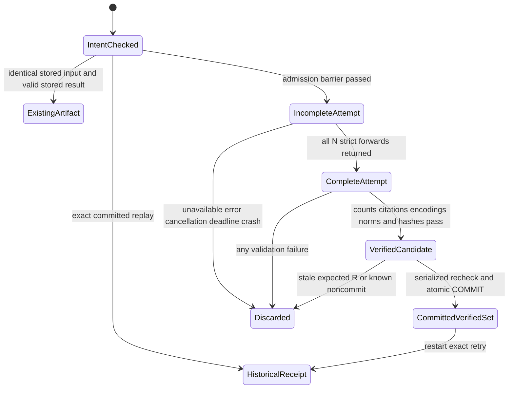

# M8 S3d.2: isolated semantic staging and exact document citations

Status: **design/feasibility gate only**. All new records, states, actions, helpers and
acceptance cases below are proposals. No semantic staging schema, encoder change, CLI,
indexing or retrieval implementation is delivered by this document.

Verified baseline: signed S3d.1 `4982faa3cdaa6f3fa051211be7692df1f2b17463`, parent signed
design `0ab3a069591f05c17a0e4e92d8c366b35c9be82e`, branch
`feat/m8-s3d1-lexical-staging`, worktree `/tmp/mindspace-m8-s3d1`, initially clean.
The reported **1147/0/11** full suite is historical, not rerun for this document-only task.
No merge, push, publication, visibility transfer or S4 is authorized.

Read with [S3d staged indexes](m8-s3d-staged-index-design.md),
[S3d.1 report](m8-s3d-lexical-staging.md), [S3 chunk/token contract](m8-s3-chunking.md),
[S3a authoritative reconciliation](m8-s3a-retrieval-ownership.md#13-reconciled-authoritative-first-slice),
[S3b Model A](m8-s3b-ownership-core-plan.md) and
[S3c preparation](m8-s3c-document-ownership-plan.md). S3a's P1a/publication alternatives
remain deferred. The implemented S3b owner remains `legacy`, epoch 1. A prepared
association and a verified lexical artifact do not grant ongoing staging/publication authority.

## 1. Existing call graph and compatibility boundary

Observed code at the baseline, not behavior of a proposed semantic stager:

```text
CLI index run
  -> active embedding.enabled / embedding.model and installation checks
  -> CandleRuntime::load(model_dir)
  -> index_assertions(Store, dyn EmbeddingRuntime, legacy EmbeddingDerivation)
  -> subject: content (or content when subject is blank)
  -> EmbeddingRuntime::embed_document
  -> encode_inner(..., validated=None)
  -> prefix -> tokenizer.encode(add_special_tokens=true)
  -> truncate token IDs and mask to 2048 if oversized
  -> Nomic forward -> attention-mask mean -> L2 normalization
  -> AssertionEmbedding(assertion UUID, legacy derivation_key)
  -> Store::save_embeddings -> assertion_embeddings, one transaction per successful item

active Semantic/Hybrid/Auto search
  -> semantic::readiness(enabled, selected model, files, ordinary vector count)
  -> hash all artifacts -> verified query runtime
  -> generic embed_query (query prefix; may truncate)
  -> Store::search_vectors -> ordinary assertion/memory/evidence/source joins
  -> cosine rank; Hybrid/Auto fuse with ordinary FTS results

existing strict document call
  -> CandleRuntime::embed_document_validated(raw source slice)
  -> TokenBudget::from_file: authenticate tokenizer; disable padding/truncation
  -> encode full document-prefix + slice + special tokens; reject >2048
  -> encode_inner(..., Some(the exact verified Encoding))
  -> same model forward/pooling/normalization; defensive second overflow rejection
```

| Actual source | Design consequence |
| --- | --- |
| [Runtime](../src/embeddings/runtime.rs), `load`, `ensure_loaded`, `encode_inner` | `load` falls back to Nomic for unknown directory names. `ensure_loaded` checks files exist but does not authenticate weights. Never select a stage pipeline by basename or generic trait fallback. |
| [Budget](../src/embeddings/budget.rs), `from_file`, `encode_document` | Strict encoding is already authoritative and preserves full input accounting. Its exact budget identity must match C. It currently reads/hashes/parses the tokenizer on every strict call. |
| [Indexer](../src/indexing/mod.rs), `index_assertions` | Adds a subject and persists each vector independently. Neither its payload nor its transaction model is correct for atomic source-chunk staging. Do not call it. |
| [Manifest](../src/embeddings/manifest.rs), `derivation_from_manifest`; [Cargo.lock](../Cargo.lock) | Manifest says Candle **0.11.0**, while resolved core/nn/transformers are **0.11.1**. Legacy descriptor binds the document prefix but not the subject formatter or query prefix. Keep it unchanged; new strict identity must bind actual versions and the source-slice payload. |
| [Core vector codec](../src/core/mod.rs), `encode_f32_le`, `decode_f32_le` | Pure reusable finite f32 little-endian codecs; dimension is separately checked. Runtime checks finite/dimension, not an independent unit-norm tolerance. |
| [Vector table](../migrations/0007_embeddings.sql); SQLite `save_embeddings`, `embedding_index_status`, `clear_embeddings`, `search_vectors` | Ordinary vectors key on `(assertion_id, derivation_key)`. Counts, clearing and all qualified vector scans observe that table; visibility filtering alone does not isolate staging. |
| [Semantic resolver](../src/retrieval/semantic.rs), `readiness` | Requires at least one compatible ordinary vector before constructing a query runtime. Unsuitable for first document indexing and must not be satisfied by staged rows. |
| [MCP semantic cache](../src/retrieval/semantic/cache.rs) | Process-local **query-runtime** cache, not a vector cache. Exact model/directory identity and qualified filesystem/stamp checks govern reuse. Staging must neither use it nor change its metadata/artifact directory. |
| [Search](../src/retrieval/mod.rs), `search_with_mode` | Explicit Semantic/Hybrid fail when unavailable; Auto may fall back to lexical. A semantic staging operation must never silently fall back. |
| [S3d.1 storage](../src/storage/sqlite/lexical_staging.rs), [0015](../migrations/0015_lexical_staging.sql) | Immutable canonical entries and receipt are a useful parent. Its lexical intent includes a deterministic result digest; floating-point staging needs a different input/result contract. |

There is currently one registry entry: Nomic v1.5, revision
`e9b6763023c676ca8431644204f50c2b100d9aab`, 768 dimensions, CPU/F32 Nomic configuration
with architectural 8192 positions but an application ceiling of **2048 total tokens**.
Pinned weights: 546,938,168 bytes, SHA-256
`9e7d262b1fe5ea350782829496efa831901b77486bbde1cea54a4c822d010d5c`.
Tokenizer: 711,396 bytes, SHA-256
`d241a60d5e8f04cc1b2b3e9ef7a4921b27bf526d9f6050ab90f9267a1f9e5c66`.
Resolved tokenizer engine: **0.23.2**. The new strict contract must reject drift between
actual compiled engine/version and the version asserted by the budget recipe.

The current tokenizer file has no padding/truncation configured. Generic runtime relies
on that file's settings and also explicitly truncates IDs/mask on overflow. Strict budget
code explicitly disables both settings. Bert normalization lowercases/normalizes accents,
handles Chinese/control characters and maps long words to UNK. Those are model behaviors;
they must not alter canonical stored source bytes or citation identities.

## 2. Selected storage and isolation model

Select **separate semantic-set, vector and receipt tables**, referencing a named immutable
S3d.1 lexical artifact. No new ordinary sources/evidence/assertions/memories/memberships,
`assertion_fts`, `assertion_embeddings`, active-model metadata or retrieval/cache entries.
No current API unions, views, aliases or triggers route staged vectors into ordinary storage.

| Alternative | Assessment |
| --- | --- |
| Separate staged tables, no active assertion/memory FK | Recommended. Existing vector scans, readiness/index counts, clears, FTS statistics, query-runtime cache and fusion cannot discover them. Reuse pure codecs, not the active vector persistence API. |
| Existing vector table with visibility metadata or only a new derivation key | Reject for this slice. Requires modifying every count, clear, backfill and direct vector consumer; ordinary assertion identity also misattributes a chunk. A different key is not a complete visibility boundary. |
| Content-addressed shared vector cache plus isolated memberships | Defer. Adds cross-artifact provenance, cache poisoning/conflicting f32 outputs, eviction/retention and reference-count lifecycle. No shared cache is needed to establish safe staging. |

Specific accidental exposure routes to exclude: `save_embeddings`, the incremental
indexer, `embedding_index_status` and model-status/readiness, `clear_embeddings`, direct
`search_vectors` with a supplied key, Semantic/Hybrid/Auto fusion, shared assertion creation
(which immediately alters FTS), and writes to `embedding.enabled/model`. Even inactive
ordinary rows can affect indexing/readiness; no ordinary rows are a staging vehicle.

A disposable current-API counterexample created one retired synthetic memory, then saved
a compatible 768-vector in the existing ordinary table. Active vector hits remained zero,
but `embedding_index_status` changed embedded count **0→1**, the actual resolver changed
**NoCompatibleIndex→Ready** (using a fake query-encoder factory, no query inference), and
`clear_embeddings` removed that row. No staged schema was created. This observed count/
readiness/clear exposure supports rejection of visibility-only shared storage; it is not
an implementation or successful isolation test of proposed semantic tables.

The new private builder accepts an explicit model/strict pipeline and lexical stage ID.
It does not read the selected active model as authority and does not enable embeddings,
install files, download artifacts or warm/clear MCP's query cache. Explicit local staging
can use already available model files while active embeddings are disabled, without
changing that setting. No semantic search surface is added, even for staged data alone.

## 3. Authority and preview contract

Preserve Model A: explicit trusted local administrative invocation by the database-owning
OS account, existing initialized DB, physical DB path/device/inode binding and S3b's
protected local target/sidecar policy. No new MCP/worker/broker opcode, ingestion hook,
metadata grant, client-supplied principal, generic IAM or authority inferred from model paths.
No distinct-human authentication or defense against malicious same-UID programs is claimed.

Proposed action: `stage_document_semantic@1`. Proposed direct CLI preview/apply may live
under the existing ownership administrative command group, but is not implemented here.
Require explicit absolute DB, lexical stage ID, official model/strict-policy selection,
expected global pre-R, nonce/full operation ID and exact confirmation. Display the pinned
preparation/Fs/Ds/X/C, source/parent hashes, strict descriptor, DB/account, expected state
and transition. No positional path-based association or automatic newest C.

Preview validates canonical parent/input bindings and constructs an **input-only** intent.
It performs no inference or model installation and makes **no model/token readiness claim**.
It may run without local weights/tokenizer files using the trusted compiled registry and
budget descriptor. This requires narrowly factoring the authoritative pure budget identity
recipe so `from_file` and preview compute exactly the same existing C identity; do not
create a second approximate recipe or change existing keys. Fresh preview requires the
compiled strict encoder feature/contract; feature-independent status/replay is separate.
Show `artifact_availability=not_checked`, `fresh_tokens=not_checked` explicitly.

The full input intent binds physical DB/account, nonce/domain, preparation and exact lexical
parent tuple, Fs/Ds/X/C/plan and canonical input manifest, strict pipeline/verification/resource
policies, mutable F/D base fingerprints, expected pre-R, and the fixed transition
`NoSemanticArtifact → CreateVerifiedUnpublishedSemanticSet`. Bounded canonical encoding
uses existing length-prefixed UTF-8, UUID bytes, fixed-width integers/tagged null conventions.
Limit both canonical and decoding representations to 64 KiB; never include all vectors or
source text in a request. Committed nonce reuse with altered intent conflicts.

A preview/full ID is not a signature or durable precommit grant. Only COMMIT of the complete
set and successful immutable receipt makes a durable outcome. Cancelling a local process is
best effort before COMMIT; there is no external revoke/lease/TTL promise. S3c/S3d.1 receipts
are provenance, not authority for this distinct action.

## 4. Input identities and immutable results

Use a new versioned canonical encoding/domain, not `EmbeddingDerivation::derivation_key`
or the legacy subject formatter. Hash delimiters/lengths unambiguously; version all recipes.

```text
parent_binding = (lexical_stage_id, lexical_operation_id, lexical_created_R, lexical_result_digest)
parent_identity = (lexical_stage_id, lexical_result_digest)
items  = ordered(entry_id, chunk_id, ordinal, Ds_byte_range, payload_hash, S1_anchor, stored_chunk_token_count)
input_manifest = H(doc-semantic-input@1, parent_identity, exact preparation/Fs/Ds/X/C/hashes, items)
pipeline_key = H(doc-source-slice-strict@1, full strict descriptor)
semantic_id = H(doc-semantic-set@1, input_manifest, pipeline_key, verification_policy)
vector_key[i] = H(doc-source-vector@1, D/Ds/X/C, entry_id, chunk_id,
                  byte_range, raw_payload_hash, pipeline_key)
result_digest = H(doc-semantic-result@1, semantic_id, ordered(
                  ordinal, entry_id, vector_key, actual_token_count,
                  actual_encoding_digest, dimension, exact_f32le_byte_digest))
operation_id = local-doc-stage-semantic@1:nonce:H(canonical INPUT intent)
```

`actual_encoding_digest` has its own canonical recipe:
`H(doc-semantic-encoding@1, pipeline_key, budget_identity, raw_payload_hash,
length_and_ordered_token_ids, length_and_ordered_attention_mask, token_type_input_none)`.
Use the same length-prefixed UTF-8 field convention, u64 big-endian array lengths and u32
big-endian IDs/mask values; require equal ID/mask lengths and count equality. Hash the
actual checked arrays passed to forward, not a second re-tokenization. The current call
passes `None` for token-type IDs; encode that explicit tag rather than claiming unused
Encoding type IDs were fed. This recipe/policy is versioned in the strict descriptor.

**Do not include `result_digest` or predicted vector bytes in preview/operation identity.**
Unlike lexical assembly, inference may differ in floating-point bits across machines or
runs. The successful receipt binds that authorized input to the **winning actual result**
and committed R. Same-input racing workers return the winner, never compare its bytes with
a loser's recomputed floats or overwrite them. No exactly-once computation/deterministic-f32
claim is made. SHA identities are deterministic for named inputs; results are separately hashed.

The parent binding references one committed lexical artifact and its exact receipt/R.
Its recording R is an envelope/FK and full-operation binding, not part of artifact hashing.
Nonce/actor, current locator, wall clock and recording R do not independently affect the
semantic artifact/vector input IDs; opaque parent identities remain snapshot-specific. A changed lexical parent, source revision, C, extractor,
range, payload or strict policy yields a different input identity. Reversion may reuse the
original named immutable parent and artifact. Equal strings under different documents/spans
cannot collide through content-only reuse, even if the tokenizer produces identical IDs.

Strict descriptor minimum:

- Official model ID/version/revision and architecture; exact weight/tokenizer sizes/hashes.
- Payload `canonical-source-slice@1`, document prefix `search_document: ` exactly once,
  expected future query prefix `search_query: `, special tokens enabled, padding off,
  full-input token contract/identity, limit 2048, overflow **reject**, no context augmentation.
- Actual tokenizers and Candle core/nn/transformers versions; CPU/F32/config digest;
  attention-mask mean over all attended tokens including prefix/special tokens; L2.
- Independent unit-norm verification policy `abs(norm_f64 - 1) <= 1e-4`, reject zero/nonfinite;
  dimension 768; exact f32 little-endian serialization; vector hash algorithm/version.
- Semantic schema/algorithm/verification versions and a conservative compiled runtime/build
  fingerprint including the embedded relevant resolved dependency versions and lock digest.
  An unrelated lock change may invalidate reuse conservatively; no unsafe compatibility guess.

Actual runtime/build metadata must be generated/checked against the resolved build, not
copied from the stale manifest scalar. Do **not** relabel existing legacy vectors or repair
the legacy descriptor in this slice. Keep the exact official ModelManifestEntry when
constructing TokenBudget; altering its runtime_version scalar would fail its registry-equality
check. Bind actual runtime metadata alongside that entry instead. Preserve C's existing token-budget identity; a changed
budget engine/contract requires explicit compatible rechunking, not rewriting C.
Expected query compatibility is metadata for later publication, not a delivered strict
query encoder or permission to reuse today's truncating query path without review.

## 5. Strict invocation and verified artifact ownership

The first implementation needs an **additive private verified document encoder**, not a
new generic embedding abstraction. Existing `EmbeddingRuntime`, legacy indexer and query
runtime keep their behavior. Proposed minimal factory:

1. Require the explicit official manifest/config and supported compiled strict contract.
   Resolve a protected local artifact directory under Model A; never use basename fallback,
   arbitrary remote weights or active-model settings to select the pipeline. No downloads.
2. Read at most the pinned tokenizer size plus one byte into owned bytes; verify exact
   length/SHA before parsing. Factor a narrow `TokenBudget::from_verified_bytes`/identity
   helper shared with the existing file path, preserving the existing C identity recipe.
3. Freshly encode **every** parent entry with this tokenizer, complete document prefix and
   special tokens, padding/truncation disabled. Require each actual count to equal C's stored
   count under the same budget identity and to be ≤2048. Any mismatch/overflow refuses the
   entire set **before reading/loading weights**. Do not repair/relabel C or silently split.
   Retain bounded counts/encoding digests, not whole-document encodings per chunk.
4. Read at most 546,938,169 weight bytes, check exact size/SHA, and load tensors from those
   **same owned bytes**. The resolved Candle 0.11.1 `safetensors::load` already uses
   `fs::read -> load_buffer`; the latter is available for this narrow factory. Owned tensor
   storage permits releasing the raw weight buffer after construction. Retain the parsed
   pinned tokenizer/budget, model and descriptor, not artifact paths to reopen per entry.
5. For each source slice, the private encoder obtains complete encoding again from the
   same trusted budget. Before forwarding, check count/digest against preflight and C,
   check the fixed pipeline/scalar configuration and defensive ≤2048 invariant. The exact
   checked IDs/mask feed inference; no public unchecked-IDs API or generic-trait fallback.
6. Return an internal verified result carrying payload/encoding/pipeline binding, actual
   total count and finite 768-vector. Validate f64 unit norm within `1e-4`, reject zero,
   encode exact f32-le bytes and hash those bytes. Persist only after the complete batch
   and all citation/vector validators pass.

This is a proposed API/refactoring gate, **not an existing verified-owned factory**.
It should narrowly reuse the current Nomic configuration and forward/pool implementation,
not duplicate a second hardcoded model. Test that descriptor, configured model, budget and
actual forward input agree. The public existing strict method may continue its current
per-call tokenizer reload; callers cannot substitute it over a mutable directory for the
owned-artifact guarantee without explicitly retaining the older stable-files assumption.

The owned snapshot handles legitimate model-manager atomic replacement: a read either
hashes to the exact selected artifact or refuses; verified owned bytes remain the same
through inference. Different model/tokenizer files cannot be mixed silently. No generic
install lock, delegated authority or protection from a hostile same-UID process is claimed.
All artifacts must verify, even though the existing strict method only authenticates the
tokenizer internally. Artifact hashes prove correspondence to the trusted registry, not
that a model is truthful or semantically distinguishes every input character.

Token examples from the actual pinned tokenizer: empty document/query costs 6 tokens;
`hello ` repeated 2041/2042/2043 times costs 2047/2048/2049. Do not subtract a universal
six-token allowance: validate the full encoding. The actual single-input template is
`[CLS]` ID 101 + encoded(document-prefix + source slice) + `[SEP]` ID 102. There is no
paired-input separator or additional structural-context sequence. The document prefix is added **once** by
the encoder; input is the exact raw canonical slice. Copied headings, section labels,
`subject: `, separators or summaries are prohibited. All attended prefix/special tokens
participate in current masked mean pooling. Whitespace-only slices are still inputs.
An empty canonical document has zero entries/vectors; its empty set needs the same official
feature/artifact verification policy but zero forward calls, and conveys no search readiness.

## 6. Proposed storage and migration

Candidate next additive migration: **0016**, recheck numbering before implementation.
No SQL is added now. Use three narrowly scoped tables:

| Proposed table | Required fields and SQL-enforceable bindings |
| --- | --- |
| `doc_staged_semantic_sets` | SHA semantic ID PK; exact lexical parent `(stage_id, operation_id, created_revision, result_digest)` FK to its existing unique tuple; input manifest; immutable strict descriptor/key; verification/resource policy; expected vector count; actual logical byte counts; result digest; operation ID and created R; state CHECK `verified_semantic_unpublished`. No owner/head/active/publishable column. |
| `doc_staged_vectors` | Semantic-set FK; parent entry ID FK; ordinal, chunk/input/vector key, payload and encoding digests, actual total token count, dimension, exact f32-le BLOB and BLOB digest. UNIQUE `(semantic_id,entry_id)` and `(semantic_id,ordinal)`; trigger joins enforce exact membership/ordinal in that header's lexical parent. No assertion/memory FK and no duplicated source text. |
| `doc_semantic_stage_receipts` | Full operation ID PK, UNIQUE committed nonce and semantic ID; bounded canonical INPUT request/version/digest and decoding BLOB; physical DB/account, expected R/base and fixed action/transition; input/pipeline/semantic identity; actual winning result digest and committed R. Immutable successful outcomes only; no precommit approval/job state. |

Mandatory FK components/tags/hashes/counts are typed NOT NULL. Fixed first policy: dimension
768, actual tokens 1..2048 for each entry, BLOB length `4*dimension` (3072 bytes), valid
SHA encodings, positive R and count 0..8192. No row for a skipped entry. Zero-count set has
zero vector rows. Same-operation/same-result/same-R deferred circular FKs tie set/receipt;
receipt insertion checks exact count, contiguous ordinals and equality with the parent's
expected entry population. Count equality alone is insufficient: private typed permits
compare every approved row, bytes, input binding and availability birth.

Private semantic action permission is independent of ordinary M6, S3b, S3c and lexical
permission. Arming is possible only after the supported private validators finish. The
ordinary record context alone cannot insert vector/header/receipt rows. Finite/unit-norm,
exact encoding/source equality and hashes are receiver validations enforced by those exact
permits, not fictitious native SQLite float-in-BLOB CHECKs.

Reject UPDATE/DELETE, PK/alternate-key INSERT OR REPLACE, conflicting UPSERT and late vector
insertion after a receipt. Use BEFORE INSERT collision guards independent of recursive
DELETE triggers. Parent canonical entries/dependencies already have S3d.1 seals; preserve
those global guards. New code factors a canonical-parent verifier out of
`verify_candidate` narrowly: all source/structure/C/entry/receipt checks remain mandatory;
lexical FTS checking is a separate optional observation. Existing lexical inspect/apply
still call both checks, preserving behavior. A corrupt lexical FTS cache does not change
canonical bytes or automatically invalidate verified semantic vectors. Conversely, intact
FTS or an old lexical receipt alone cannot verify a new semantic set.

Add the new triggers/functions to persistent enforcement inventory and register private
semantic context in every build, including without embeddings for receipt/inspection.
Migration installs only empty storage, schema registration and one
`semantic_staging_schema/local-doc-stage-semantic@1` R_meta through existing
`MigrationRevisionScope`. Explicitly check FKs while migration enforcement is temporarily
disabled; restore settings/scopes on every exit. Populated schema 15 retains all old
rows, vector/FTS bytes, ownership and temporal dimensions. Do not rerun the M6 baseline,
backfill vectors, read model files or infer authority during open/migration. Known failure
rolls back DDL/marker/R; unknown cutover uses healthy reopen registration/marker evidence.
Repeated open consumes no extra R_meta. Older binaries reject schema 16; no destructive down.

## 7. Transaction and recovery state machine

Only the final verified set is durable. Other states are bounded process-local work:



`CompleteAttempt` is not verification. `verified_semantic_unpublished` means one historical
complete semantic verification committed. **Publishable is never a state.** No durable
partial rows, resumable queue, incremental save, background job lease or mutable selected head.

Proposed sequence for a valid apply request:

1. Establish existing local admin context/physical DB, parse the input-only ID and exact
   supplied bindings/confirmation. Read a committed receipt first, validate its stored
   input canonical bytes/digest and result binding, and return its original outcome/R.
   Do not reconstruct current source/model state before this exact historical replay.
2. If not observed, use a bounded `BEGIN IMMEDIATE` admission check. Recheck receipt first;
   check committed-nonce conflict and a same-input existing artifact. Validate input intent,
   canonical parent, expected pre-R and mutable base. Roll back unused R and release all
   SQLite transaction/connection guards. This is not a durable approval, reservation or
   prevention of duplicate inference; parent validation may read up to the full bounds.
3. Build from one owned, validated canonical snapshot: token preflight, authenticated owned
   model, sequential strict calls, full candidate validation. No database writer, Store mutex
   or long-lived read transaction is held during model loading/inference. No per-entry
   full-source/retained-blob read or whole-weight hash is repeated.
4. Reacquire `BEGIN IMMEDIATE`. Receipt first: return the race winner's original receipt,
   rolling back unused R and discarding the candidate. Next, same-artifact status validates
   the stored winning vectors/input/citations independently and spends no R/receipt; never
   compare f32 bytes with a losing recomputation. Conflicting nonce/input remains conflict.
5. For a new set, enforce exact expected pre-R/base and reread/hash the parent/dependencies/
   input manifest. Catch out-of-band corruption even if R did not change. Refuse stale
   state; no automatic rebasing or latest source selection. No inference inside this writer.
6. Arm exact semantic permission. Insert set, all vectors, successful receipt and availability
   in one transaction; validate FKs, complete membership, counts, digests and context. Commit
   through existing outcome classification. Clear permission on every exit and permanently
   discard uncertain administrative handles. Output loss after commitment can be UNKNOWN.

For any model/preflight/inference failure **after request binding**, make at most one bounded
serialized receipt observation before the terminal response: a concurrent matching winner
can resolve the operation successfully despite this worker's failed computation. Do not
convert malformed/wrong-intent requests into success. If no receipt exists at that barrier,
report `NoCommit` **for this invocation**, plus `NotObserved` for the operation at that
barrier. A later live/paused worker may still commit. Busy/unavailable recovery yields an
unresolved/UNKNOWN operation observation, without erasing the known local no-write fact.
Never claim the original UNKNOWN operation rolled back merely because a retry succeeds.

Historical receipt validation decodes and hashes the **stored** supported descriptor;
it must not demand equality with the current binary's fresh-encoder build fingerprint or
perform a registry/model-directory lookup first. Otherwise upgrades/no-embeddings builds
would break legitimate replay. Parse caller IDs/hashes before this path; current model/
pipeline support checks apply only to new computation. Versioned unsupported historical
codecs fail explicitly, never turn a committed record into a rollback or silently reinterpret
its bytes. Known v1 stored-vector inspection remains independent of the Candle backend.

The receipt/result paths and pure vector/canonical integrity checks compile without
embeddings. Exact retry and existing-artifact status precede feature/model availability
checks. A new creation without the feature/files fails explicitly, preserves lexical/F
state and never downgrades to lexical. Only a successful receipt consumes one R; admission,
status, unsuccessful attempts and inspection roll back any allocated R. No exactly-once
process execution, external revocation or machine-wide inference exclusion is promised.

## 8. Lifecycle, inspection and citations

| Event | Required outcome |
| --- | --- |
| First staging | Explicit named lexical parent and compatible official strict contract; complete verified set or no semantic rows. Legacy owner/search unchanged. |
| Exact retry after metadata changes, deletion or missing model | Original receipt first, same physical DB/account and input/R parameters; no model construction or new R. Historical verification only. |
| Changed intent/full-ID reuse or committed nonce rehash | Conflict before/after commitment. A different uncommitted intent needs fresh explicit confirmation; nonce alone is not durable approval. |
| New ID, existing exact semantic artifact | Read-only ExistingArtifact status after current stored-result/canonical verification, before model work; no fabricated receipt or R. Encoder availability separate. |
| Mid-job forward failure or crash | Discard all partial process-local vectors; no persisted partial completeness. Resolve any concurrently committed matching receipt as above. |
| COMMIT veto/rollback vs lost acknowledgement | Known noncommit rolls back this transaction; admitted uncertain COMMIT remains UNKNOWN until durable evidence on the original healthy DB resolves it. |
| Concurrent same input | Duplicate computation is allowed; serialized first valid commit wins. Loser reuses winning result without float equality assumptions. |
| Different input/pipeline racing | Conservative expected global R allows one new commit; loser must explicitly refresh/reconfirm. Released admission barriers do not reserve R. |
| Wrong/missing/corrupt C or parent | Refuse new construction/current source verification; never switch C/extraction or infer a head. Historical receipts remain historical. |
| File absent/replaced, blob erased | Retained canonical citation remains exact; no original/live-file authenticity claim. No source erasure/deactivation or latest-revision fallback. |
| Source changed/reverted or new extractor/chunker | New explicit lexical parent/input, or exact reuse of the old named parent. No automatic refresh or cross-revision stable-position claim. |
| Weights/model revision/tokenizer upgrade | Explicit new strict contract. Existing budget identity includes model ID AND revision, so even unchanged tokenizer bytes may require new C/lexical parent. No automatic compatibility alias or rechunk. |
| Runtime/algorithm change with exact same budget | New semantic pipeline/artifact; C/lexical parent may be reused only if its exact required budget identity still matches. Old outputs are immutable, not overwritten. |
| Corrupt semantic rows or missing weights after commit | Stored-vector/canonical integrity and current encoder availability are separate. Missing weights alone do not invalidate historical vectors; corruption refuses current verification and is never overwritten by reindex. Repair/GC is a later action. |

Every vector resolves through its parent entry to D, Ds/hash, X/extractor identity, exact
C/plan/chunk ID, full S1 root anchor and half-open canonical byte interval. Require the
same byte-exact quote as S3d.1, using one snapshot/batched resolver, never copied heading
metadata or a new vector-generated quote. Preserve UTF-8 codepoints, CRLF, normalization
forms and bidi/zero-width controls. Grapheme splitting follows S3's existing boundary;
renderers escape controls/HTML without changing source or anchor bytes.

Inspection validates header/receipt, ordered entry population, raw payload/source mapping,
vector keys, finite/dimension/norm/BLOB hashes and the committed result digest. It does not
rerun inference or require weights. Report separate observations: historical verified R;
current canonical-source integrity; stored-vector integrity; fresh token revalidation
`not_checked` unless explicitly performed; lexical FTS integrity `not_checked` unless
explicitly checked; current encoder availability `not_checked` unless inspected. An old
receipt is not current readiness, source freshness or approval. A combined search-ready or
publishable boolean is prohibited. Original-byte authenticity remains `not_checked`.

Existing `.at(T)` remains timestamp-based lifecycle search using current memberships/index
storage. New availability at R records only when a staged artifact became known; it does
not implement recorded-revision retrieval, historical rankings or historical file presence.

## 9. Resource and concurrency budgets

Initial fixed profile `doc-semantic-local@1`, bound in the operation intent:

- One document, one CPU model/runtime and one forward at a time **per process**; batch 1.
- Inherit parent limits: canonical text ≤16 MiB, ≤8192 entries and ≤16 MiB parent metadata.
  Refuse the whole attempt above bounds; never silently skip entries.
- At most 8192 forwards; actual aggregate tokens ≤16,777,216 (8192×2048), preflighted.
- Raw vector bytes ≤25,165,824 (24 MiB); semantic metadata ≤8 MiB; logical candidate charge
  ≤64 MiB over canonical text, parent entry metadata, vectors and semantic metadata.
  Counts/encoding digests are bounded; do not retain every full token Encoding.
- Input/receipt decoding representations ≤64 KiB each. Charge header/receipt metadata even
  for empty sets. Admit at most 128 MiB aggregate semantic vector-plus-metadata charge under
  the writer, independently of lexical staging's 256 MiB logical quota. No auto-erasure.
- Cooperative 600-second attempt deadline, checked around file reads, between entries and
  before commit. In-progress Candle calls are not hard-preempted; one call can overrun.
  Deadline/work exhaustion discards the entire candidate and performs bounded receipt
  recovery. Larger supported profiles would require a separate reviewed policy/version.

These are logical/work admission budgets, **not** hard RSS, physical DB/WAL, CPU-thread or
machine-wide quotas. Raw weight bytes, loaded tensors, activations, SQLite and private
permit copies add memory. Hash/load one model per attempt and release raw weights promptly.
Do not impose a global SQLite page cap that could break legacy writes.

SQLite admission/commit barriers do not serialize inference after the writer is released.
Several trusted CLI processes can each allocate a model and duplicate work; aggregate
memory/CPU scales with that concurrency. First-slice protocol tests use six fake-encoder
workers; real-model tests run serially or under an explicitly measured host/OS limit.
Operators needing a machine-wide availability bound must use OS admission limits. A new
protected per-DB compute-lock primitive is optional later availability work, not a hidden
assumption, ownership fence or requirement for idempotent durable effects in this slice.

A busy database can make a long computation stale under conservative global R checks.
There is no automatic rebase, partial resume or inference retry loop. Quota/deadline refusal
is an honest limitation, not permission to publish a smaller subset. Append-only retention,
cache repair, scheduler fairness and streaming/resumable model jobs are deferred.

## 10. Executable implementation acceptance matrix (proposed)

None of these semantic-stage tests exists or passed in this documentation task. Implement
in disposable schema-15 fixtures, with private fake encoders/faults only in tests, plus
serial real Nomic sentinel/boundary probes. Test actual production/no-embeddings binaries
separately and verify test hooks absent. Every case checks no ordinary knowledge/index
mutation and no partial verified state, not just an error string.

| ID / executable case | Required oracle |
| --- | --- |
| A1 `explicit_semantic_authority_only` | Correct existing DB/account and exact new action succeeds; missing/wrong context, env-default DB, arbitrary principal/path, metadata, S3c/lexical permit, ordinary M6 and MCP refuse. Preview performs no inference/download or readiness assertion. |
| A2 `input_intent_not_float_result` | Preview produces the same input ID without inference. Change DB/UID/parent/model/policy/expected R/base/transition under the same ID: conflict. Committed nonce rehash conflicts. Different valid f32 results for identical input do not change input identity or overwrite a winner. |
| I1 `keys_do_not_alias_legacy_or_other_spans` | Fixed golden canonical encodings; same source/pipeline stable keys, while D/Ds/X/C/entry/range/raw payload/model/tokenizer/prefix/normalization/dimension/algorithm/build changes differ or refuse. No legacy derivation key; model-equivalent UNK/control variants still have distinct raw source keys. |
| I2 `actual_build_descriptor` | Capture actual compiled dependency/config identity. Stale manifest 0.11.0 cannot label the new 0.11.1 strict runtime. Factor pure descriptor/budget recipes once; tests preserve existing C identities and legacy keys. Cross-feature receipt decoding is identical. |
| T1 `full_prefix_special_token_ceiling` | Actual 2047/2048 inputs accepted; 2049 refuses before weight access. Complete Encoding IDs/mask handed to forward match the checked count/digest. Prefix added once, special tokens included, padding/truncation disabled. Removing prefix/specials/final check must kill the test. |
| T2 `strict_route_no_generic_fallback` | Generic `embed_document`/`embed_query` sentinel panics if reached by the builder. Adding subject/context/header to a full slice refuses; malformed/forged C counts or incompatible budget refuse even when payload fits. No silent split. |
| T3 `empty_unicode_and_adversarial_text` | Empty canonical document zero vectors; whitespace slices encoded, Unicode/CJK/emoji/combining/CRLF/bidi/zero-width/long words retain raw hashes/citations. Every actual count matches C; tokenizer normalization does not become source normalization. |
| M1 `verified_bytes_are_used_bytes` | Wrong-size/hash model or tokenizer refuses. Swap files between metadata check/hash/read/load; the owned verified bytes are the ones loaded, or refuse. Replace paths after owned factory construction: job retains the original selected model/tokenizer, no mixed new file per chunk. |
| V1 `full_vector_integrity` | Exactly 768 finite f32 values, unit norm within 1e-4, nonzero, 3072-byte LE BLOB, matching payload/encoding/pipeline/key/digest. NaN/Inf/zero/nonunit, wrong dimension, extra/truncated/swapped bytes refuse before private write permission. No float canonicalization hiding byte differences. |
| C1 `canonical_parent_not_fts_readiness` | Wrong/missing parent receipt, Fs/Ds/X/C/plan/structure/range/hash/entry refuses. Canonical entry verification is batched. A damaged lexical FTS cache is reported separately and neither authenticates nor silently invalidates the canonical semantic source. |
| C2 `same_citation_after_replacement_or_erasure` | Re-ingest/revert/source deletion/blob erasure leaves the original retained D/Ds/X/C quote exact; wrong/newer anchor is never substituted. Optional original/live bytes remain not checked. Parent text cannot be modified under ordinary SQL. |
| S1 `semantic_sql_constraints_and_seals` | Direct SQL, ordinary authorized M6, FK off/on and recursive triggers off/on, PK/alternate-key REPLACE, UPDATE OR REPLACE, UPSERT, nullable FK, late vector/receipt insertion and false state transitions refuse. Positive ordinary-M6 control proves the denial is action-specific. |
| S2 `count_is_not_complete_verification` | Correct counts but one bad payload/key/encoding/vector/citation cannot commit. Remove a row, reorder/duplicate ordinals, attach another parent's entry or omit the same-R receipt: atomic refusal; no durable complete state. |
| R1 `receipt_before_model_and_feature` | Exact replay after restart, metadata changes, missing/corrupt artifacts and no-embeddings build returns original receipt/R before factory access. Changed intent stays conflict. Current integrity/encoder observations are not invented by historical replay. |
| R2 `existing_artifact_without_recompute` | New confirmed ID/same input returns current verified stored-result status with no inference, receipt or R. Loser's deliberately different valid floats do not conflict with or replace the stored winner. Corrupt stored rows refuse current status. |
| Q1 `six_workers_and_stale_admission` | Six same/different requests with fake encoders, pauses before/after both barriers and before COMMIT. One winning input/result/receipt; stale global R/base refuses new sets; unused R rolled back. Admission does not reserve work or prevent duplicate inference. |
| Q2 `inspection_waits_for_commit_or_rollback` | Separate processes inspect while rows are uncommitted: block/refuse safely, then see full set after commit or absence after rollback; no partial readiness or extra R. Include an already-open Store test to isolate the inspector barrier from admin opening. |
| F1 `nth_forward_and_preflight_failure` | Nth strict call, hash, norm, count, deadline or model load fails: no semantic row/receipt/R. Concurrent matching winner may still resolve success; failure finalizer looks up receipts once, not a global rollback claim. |
| F2 `crash_veto_unknown_and_output_loss` | Kill during computation, Nth vector insert, receipt insert and commit; inject veto, lost acknowledgement, poisoned handle and broken stdout. Known rollback leaves no partial rows/R; UNKNOWN is preserved and exact restart retry returns durable winner. |
| F3 `busy_recovery_is_not_rollback` | Receipt absent while a writer holds the lock, timeout, model failure racing a commit, delayed old process after a successful retry: no false rollback/death/exactly-once claim; every new commit rechecks inside the writer. |
| L1 `model_budget_upgrade_and_reversion` | Explicit new pipeline; reuse lexical C only when exact required budget identity matches. Changed model revision may require new C even with equal tokenizer bytes. No active-model setting change, alias, automatic rechunking or old vector overwrite. |
| H1 `active_vectors_and_ranking_unchanged` | Real populated legacy vectors/memories/spaces plus S3c/S3d.1 parent: compare exact ordinary vector/FTS shadow bytes and counts, all index/status candidates, ownership, memberships and lexical/Semantic/Hybrid/Auto results/scores/order before/after. Pin one pre-stage T for as-of queries. No assertion/memory duplicates. |
| H2 `cache_and_interfaces_unchanged` | Real MCP default tool list/unknown-tool refusal unchanged. Warm and cold active query-cache factory/hash/snapshot behavior unchanged when staging; disabled/no-compatible active index remains unavailable/Auto-fallback. `clear_embeddings` and backfill cannot touch staged rows; no current API exposes them as active vectors. |
| G1 `populated_fifteen_upgrade` | Actual schema 15 with legacy vectors, ownership/preparation receipts and several lexical stages → candidate 16, one R_meta, no model access/backfill, exact old rows/query results and M6 baseline/dimensions preserved; reopen no-op, older binary refuses. |
| G2 `migration_failure_unknown_inventory` | Late DDL/FK/marker failure, commit veto/lost ACK, missing trigger/function inventory: known failure exact schema 15; committed unknown resolves registration/marker once; scopes/FK settings restored. |
| B1 `bounded_work_and_whole_set_refusal` | Below/at/above bytes, entries, total tokens, vector/metadata/candidate/aggregate quotas; many tiny sections and zero-entry metadata charge; cooperative deadline before/after a slow call. No silent omission, global page cap or hard RSS/preemption claim. |
| P1 `publication_is_unrepresentable` | No owner/head/visibility/publishable state or endpoint; semantic verification and receipts cannot transfer ownership, retire legacy episodes or authorize later publication. Recorded-R search remains absent. |

Useful mutations: route through the generic encoder, omit prefix/special-token accounting,
trust C's counts, reload a replaced artifact after hashing, label with legacy/stale runtime
key, drop entry-parent membership or same-result FK, accept NaN/zero vector, compare race
winner floats, skip inside-writer receipt check, swallow a vector insertion failure, or
write through `save_embeddings`. Each must compile and fail its intended invariant oracle;
compilation/infrastructure failures do not count. Mutations and qualification must use
independent source **and Cargo targets**, avoiding the earlier S3d.1 shared-artifact trap.

## 11. Smallest subsequent implementation slices

No implementation is authorized by acceptance of this document. Independently reviewable
production slices, still without active search/publication:

1. **Strict contract prerequisite:** authoritative pure descriptors, budget identity reuse,
   canonical-parent validation separated from optional FTS cache checking, and private
   verified-owned document encoder. Unit/sentinel/actual-boundary/owned-byte race tests;
   existing public runtime behavior and legacy keys unchanged. No staging schema yet.
2. **Atomic semantic persistence:** additive schema/private context/immutable receipts,
   input-only operations and stored-result inspection using deterministic fake encoders in
   tests. Populated migration, SQL guards, replay/UNKNOWN/concurrency and no-feature tests.
3. **Explicit end-to-end construction:** direct local admin preview/apply, bounded preflight
   and real official encoder outside the writer; two barriers and failure receipt recovery;
   full populated isolation, real-model resource and production-binary tests. No staged search.

These slices compose one verified semantic component; intermediate schema/fake-encoder test
work is not real-model acceptance. Before its final local commit run locked fmt/strict
Clippy/full tests, targeted release/adversarial/mutation/no-feature/production-hook suites
and independent final review. Escalate rather than add shared active storage/cache writes,
inference under the DB writer, an output-bound preview, implicit installation, automatic
R refresh or a publication flag to make the implementation fit.

Remaining publication blockers are unchanged: explicit cross-kind owner/current-head policy,
all legacy writer/path/move/absence fencing, membership and temporal episode reconciliation,
provenance-safe active assertion/evidence/vector allocation, strict query compatibility,
one-snapshot readers and atomic legacy visibility retirement/document activation under new
publication authority. Recorded-revision retrieval is another gate. Neither a verified
semantic set nor possession of model files supplies any of those guarantees.

## 12. Evidence executed for this design gate

**Executed existing-code tests**, locked release build on the verified baseline:

| Existing suite | Passed | Failed | Ignored |
| --- | ---: | ---: | ---: |
| `document_chunking` | 5 | 0 | 1 |
| `document_chunks` | 15 | 0 | 1 |
| `embeddings` | 36 | 0 | 0 |
| `indexing` | 22 | 0 | 0 |
| `lexical_staging_admin` | 26 | 0 | 2 |
| `m6_temporal` | 19 | 0 | 0 |
| `retrieval` | 29 | 0 | 0 |
| `token_budget` | 5 | 0 | 1 |
| **Total** | **157** | **0** | **5** |

Command: `cargo test --locked --release --test token_budget --test document_chunking
--test document_chunks --test indexing --test embeddings --test retrieval
--test m6_temporal --test lexical_staging_admin`. Separately,
`cargo test --locked --release --no-default-features --test retrieval` passed **29/0/0**.
These are overlapping baseline regression checks, not newly implemented semantic-stage
acceptance tests; do not add them to the historical full-suite count. Tests needing the
real local administrative/process boundary ran outside the outer tool sandbox. Fixture
Git signing was disabled only through per-process `GIT_CONFIG_COUNT`; no Git config changed.

**Existing opt-in inference test**, `token_budget::measure_actual_inference_on_representative_inputs`,
was explicitly invoked using cached public model files, with no download. It stream-hashes
both exact pinned artifacts before eight strict prose/code/Unicode/control calls. It passed:
first prose call 1269.54 ms including initial model load; warm calls ranged 239.18–705.66 ms
for 30–198 total tokens. Whole test elapsed 5.22 s; observed peak child RSS **1,091,792 KiB**.
The five ignored cases in the ordinary targeted invocation remain reported as ignored;
this one explicit execution is separate evidence, not five extra passing tests.

**Disposable Rust probe**, `/tmp/m8-s3d2-probe`, depends on the unchanged baseline crate.
Its final resolved dependency versions/checksums were compared against the baseline
Cargo.lock and all matched; the final build used `--locked --offline`. Initial standalone
lock generation selected newer cached unrelated dependencies and was excluded. The probe
was repinned from the baseline lock and rebuilt before the measurements below. No repository
Cargo file or production source was changed. One process, no DB writes for runtime timings:

| Observed existing operation | Measurement |
| --- | --- |
| Stream-verify 546,938,168-byte weights, three runs | median **321.44 ms** |
| Stream-verify tokenizer, three runs | median **0.435 ms** |
| `TokenBudget::from_file` hash/parse/setup, three runs | median **17.37 ms** |
| Strict empty input, six tokens, first model load | **340.60 ms** |
| Strict whitespace, six tokens, warm | **109.50 ms** |
| Strict Unicode/controls, 94 tokens, warm | **216.85 ms** |
| Strict exact-limit input, 2048 tokens, warm | **3600.60 ms** |
| Strict 2049-token refusal | **29.00 ms**, explicit budget error |

All four outputs were finite, 768-dimensional, 3072-byte f32-le; measured f64 norms were
0.9999999593–1.0000000200 and satisfy the **proposed** 1e-4 check. The current runtime does
not itself enforce that tolerance. Probe elapsed 5.38 s; peak child RSS **1,250,912 KiB**
(about 1.19 GiB), including hashing/loading/earlier calls and the 2048-token case. This is
one host observation, not a worst-case RAM bound or a measurement of the proposed owned
factory, DB commit, whole document staging or 8192-chunk throughput. Other build/test jobs
ran concurrently; file cache warmth differs between runs. No cross-run speedup claim.

**Disposable current-storage probe** in the same package used an actual schema-15 SQLite
store with synthetic retired memory and a unit 768-vector. It verified ordinary embedded
count 0→1, `NoCompatibleIndex→Ready` with a fake query encoder, zero active vector hits,
and removal by `clear_embeddings`. The default model artifact hashes were checked by the
existing resolver; no query inference was called. It used only current tables in its own
`/tmp/m8-s3d2-vector-probe-*` DB, not proposed staging tables or a live user database.

**Exact projections, not measurements:** N entries need N strict forward calls and
`3072*N` vector bytes. For 8192 entries that is 25,165,824 bytes, excluding row metadata,
SQLite pages/WAL and model/tensors. A simple product of the single-process observed peak
and six processes would be about 7.16 GiB, not an observed aggregate or safety limit.
Tokenization setup repeated per old strict call could also add substantial cost; the
proposed owned factory should prove equivalence before claiming that repeated work removed.
No full-corpus throughput or publication-transaction cost was measured.

Local raw evidence: `/tmp/m8-s3d2-existing-targeted.log`,
`/tmp/m8-s3d2-no-embeddings-retrieval.log`, `/tmp/m8-s3d2-existing-inference.log`,
`/tmp/m8-s3d2-runtime-probe.log`, `/tmp/m8-s3d2-vector-isolation-probe.log` and
`/tmp/m8-s3d2-probe-pinned-build.log`. These are session evidence, not permanent production
artifacts. No proposed semantic-stage test/schema/API is represented as already passing.

Final design checks and independent review: signature/lineage and initially clean state verified; existing tests/probes above passed;
`cargo fmt --check`, document links/anchors/fences/whitespace, one-document-only scope and
unchanged refs/worktrees checked. No full-suite or Clippy rerun is claimed for this design.
Independent read-only Sol architecture and complete-document/source/evidence review found
no blockers. Review clarified the canonical encoding digest, explicit CLS/SEP template and
per-chunk token-count naming before the final dry pass.

Design outcome: **ACCEPT for the bounded isolated-semantic-staging design/feasibility gate**, subject to the stated Model A assumptions and future executable implementation gates. Only this new Markdown document may change;
leave it uncommitted for review. No schema, production embedding/ingestion/indexing/retrieval,
MCP, ownership transition, publication, merge, push or S4 change is delivered.

## 13. Implementation handoff authorization

The subsequent user request explicitly authorizes implementing the isolated semantic
component after this complete design passes its final code/architecture review. This
supersedes the earlier document-only handoff restriction, not the exclusions above.
The final Sol architecture gate found no blocking contradiction with S3d.1 production
code. Implementation must use a dedicated branch/worktree from the signed design commit,
complete all applicable acceptance gates, and leave production changes uncommitted for
review. No publication, active vector/search route, legacy writer fencing, recorded-R
retrieval, new MCP tool, merge, push or S4 is authorized. Model identity must include
verified actual asset bytes and effective configuration, never only dependency metadata.
